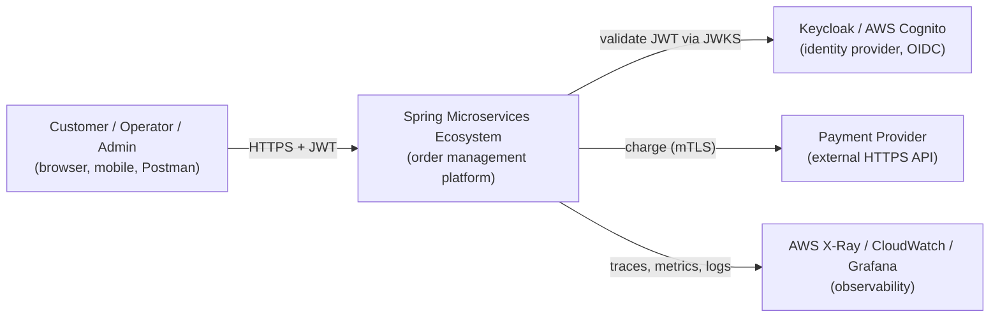
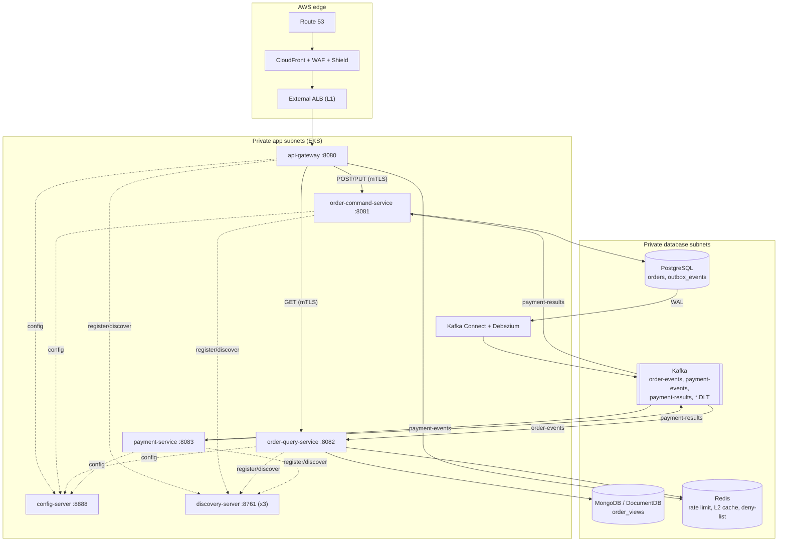
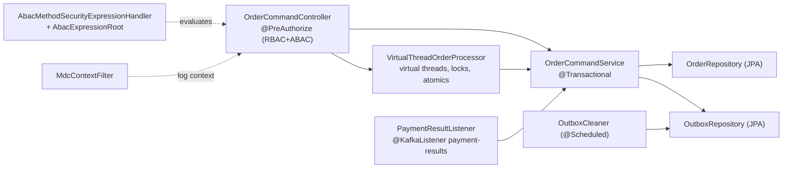
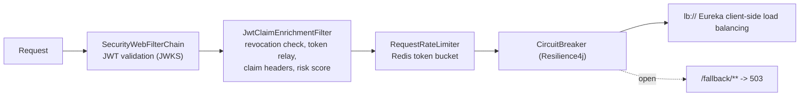
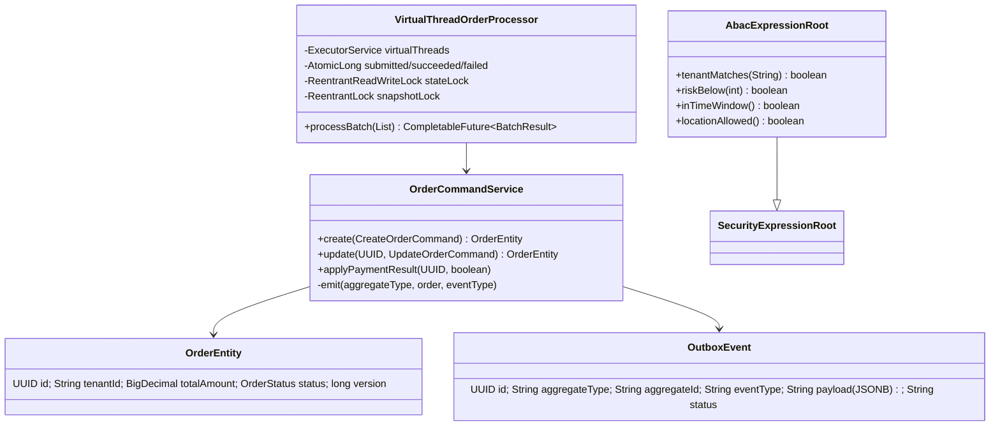
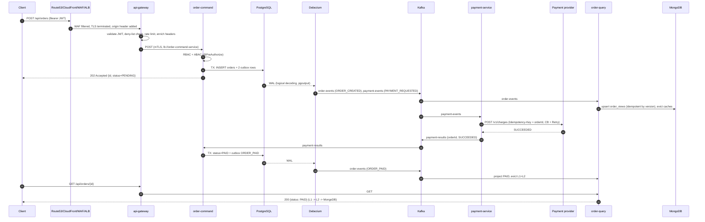
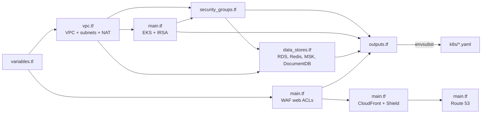
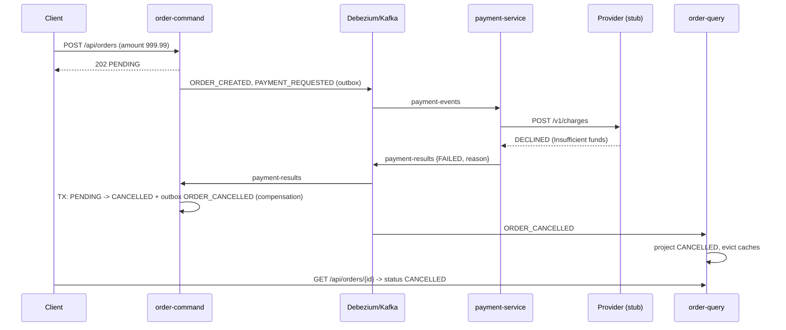

# Spring Microservices Ecosystem

Java 21 · Spring Boot 3.3 · Spring Cloud 2023.0 · Kafka · Debezium · PostgreSQL · MongoDB · Redis · Keycloak · Terraform · Kubernetes (EKS)

An order-management reference platform that demonstrates production-style microservice patterns on a Multi-AZ AWS design: CQRS, Transactional Outbox with Debezium CDC, an event-driven Saga with compensation, zero-trust security (OAuth2/OIDC, RBAC + ABAC, mTLS), resilience (circuit breaker, retry, dead-letter topics), two-level caching and full observability.

> **Read this first: scope and honesty notes**
>
> * The business domain in this repo is **Orders + Payments** (`order-command-service`, `order-query-service`, `payment-service`). There is **no flight/hotel/sightseeing domain** and **no "passenger name starting with FAIL" rule** in the code. Section 16 explains the real failure paths, shows how to trigger a payment decline deterministically, and gives an optional 6-line change if you want the `FAIL` rule. Section 17 provides the travel-budget SQL as a **proposed extension** with its own schema.
> * "Booking command service" in your notes = **`order-command-service`** in this repo.
> * The code was generated and fixed iteratively; the local Docker flow has been compiled on your machine, but the **AWS/Terraform/Kubernetes parts have not been applied to a real account**. Section 18 lists known issues to verify before production.
> * KPI and performance numbers are **design targets**, not measurements.

---

## Table of contents

1. [Architecture at a glance](#1-architecture-at-a-glance)
2. [The Four C's of architecture (C4 model): HLD and LLD](#2-the-four-cs-of-architecture-c4-model-hld-and-lld)
3. [End-to-end workflow](#3-end-to-end-workflow)
4. [Microservice catalogue (6 parameters each)](#4-microservice-catalogue-six-parameters-each)
5. [Repository map](#5-repository-map)
6. [Run locally: exact startup order](#6-run-locally-exact-startup-order)
7. [Testing walkthrough](#7-testing-walkthrough)
8. [AWS edge: Route 53, CloudFront, WAF, Shield Advanced](#8-aws-edge-route-53-cloudfront-waf-shield-advanced)
9. [Terraform: how it works and where to start](#9-terraform-how-it-works-and-where-to-start)
10. [Kubernetes: how it works and where to start](#10-kubernetes-how-it-works-and-where-to-start)
11. [Design patterns used, when they fire and their workflow](#11-design-patterns-used-when-they-fire-and-their-workflow)
12. [Deep dive: API Gateway rate limiting](#12-deep-dive-api-gateway-rate-limiting)
13. [Deep dive: JWT + OAuth2/OIDC](#13-deep-dive-jwt--oauth2oidc)
14. [Deep dive: RBAC and ABAC](#14-deep-dive-rbac-and-abac)
15. [Deep dive: Saga, Transactional Outbox, Debezium CDC, CQRS, Circuit Breaker, Eureka](#15-deep-dive-saga-transactional-outbox-debezium-cdc-cqrs-circuit-breaker-eureka)
16. [Failure flows](#16-failure-flows)
17. [SQL reference (including the travel-budget query)](#17-sql-reference-including-the-travel-budget-query)
18. [Known issues and production checklist](#18-known-issues-and-production-checklist)

---

## 1. Architecture at a glance

```
Route 53 -> CloudFront + WAF + Shield -> external ALB (L1, public subnets) -> api-gateway
        -> (mTLS, Eureka client-side LB, Resilience4j) -> order-command / order-query / payment (L2, private subnets)
order-command -> PostgreSQL (orders + outbox_events) -> Debezium (WAL) -> Kafka order-events / payment-events
order-query   <- Kafka order-events -> MongoDB read model, L1 Caffeine + L2 Redis cache
payment       <- Kafka payment-events (@RetryableTopic, DLT payment-events.DLT) -> payment-results -> order-command
```

| Service | Port | Mgmt port | Role |
|---|---|---|---|
| config-server | 8888 | 9090 | Central, encrypted configuration |
| discovery-server | 8761 | 9090 | Eureka service registry |
| api-gateway | 8080 | 9090 | Single entry point, authN, rate limit, circuit breaker |
| order-command-service | 8081 | 9090 | CQRS write side + transactional outbox |
| order-query-service | 8082 | 9090 | CQRS read side + L1/L2 cache |
| payment-service | 8083 | 9090 | Saga participant, payment provider integration |

The management port (`/actuator/*`) is intentionally separate from the application port so that Kubernetes probes and Prometheus can scrape without client certificates, while the application port can enforce mTLS.

---

## 2. The Four C's of architecture (C4 model): HLD and LLD

The C4 model describes the same system at four zoom levels: **Context, Containers, Components, Code**. Levels 1 and 2 are the **High-Level Design (HLD)**; levels 3 and 4 are the **Low-Level Design (LLD)**.

### Level 1 - System Context (HLD)

*Who uses the system and which external systems does it depend on?*



### Level 2 - Containers (HLD)

*Which deployable units and data stores exist, and how do they talk?*



### Level 3 - Components (LLD)

*What is inside each container? (Spring beans / packages)*

**order-command-service**



**api-gateway**



**order-query-service**: `KafkaOrderEventConsumer` (projector) → `OrderViewRepository` (MongoDB); `OrderQueryController` → `OrderQueryService` (`@Cacheable`) → `TwoLevelCacheManager` (`TwoLevelCache` = Caffeine L1 + Redis L2, Redis pub/sub eviction) ; `KafkaConsumerConfig` (retry + DLT).

**payment-service**: `PaymentSagaConsumer` (`@RetryableTopic`, `@DltHandler`) → `PaymentGatewayClient` (`@Retry` + `@CircuitBreaker`) → `RestClient` from `MtlsClientConfig` (SSL bundle) ; publishes to `payment-results`.

### Level 4 - Code (LLD)

*Key classes and their relationships (order-command-service).*



The write transaction in `OrderCommandService.create`:

```
BEGIN;
  INSERT INTO orders ...                                   -- state
  INSERT INTO outbox_events (aggregate_type='order',   event_type='ORDER_CREATED' ...)
  INSERT INTO outbox_events (aggregate_type='payment', event_type='PAYMENT_REQUESTED' ...)
COMMIT;                                                    -- all three or nothing
```

---

## 3. End-to-end workflow

### 3.1 One-line flow

```
Route 53 -> CloudFront + WAF + Shield -> external ALB (L1, public subnets) -> api-gateway
        -> (mTLS, Eureka client-side LB, Resilience4j) -> order-command / order-query / payment (L2, private subnets)
order-command -> PostgreSQL (orders + outbox_events) -> Debezium (WAL) -> Kafka order-events / payment-events
order-query   <- Kafka order-events -> MongoDB read model, L1 Caffeine + L2 Redis cache
payment       <- Kafka payment-events (@RetryableTopic, DLT payment-events.DLT) -> payment-results -> order-command
```

### 3.2 Happy path, step by step ("create an order")



| Step | Component | What happens | Typical latency target |
|---|---|---|---|
| 1-2 | Route 53, CloudFront, WAF, ALB | DNS, TLS termination, managed rules, rate rule, origin-verify header | < 30 ms |
| 3 | api-gateway | JWT signature + expiry + issuer, Redis deny-list lookup (200 ms timeout), token bucket, header enrichment | < 15 ms |
| 4-5 | order-command | Method security, validation, one DB transaction | p95 < 80 ms |
| 6 | Client | Receives 202 immediately; the rest is asynchronous | - |
| 7-9 | Debezium, Kafka, order-query | WAL to topic to Mongo projection | p95 < 1 s end to end |
| 10-13 | payment-service | Provider call with retry/circuit breaker | provider dependent (timeout budget a few s) |
| 14-17 | Saga completion | order becomes PAID or CANCELLED | seconds |
| 18-19 | order-query | Read from L1/L2/Mongo | L1 < 2 ms, L2 < 10 ms, Mongo < 30 ms |

**Eventual consistency:** a `GET` issued immediately after `POST` can return `404` (projection not delivered yet) or `PENDING` (saga not finished). This is a deliberate CQRS trade-off.

---

## 4. Microservice catalogue (six parameters each)

Targets below are design goals to validate with load tests, not measured results.

### 4.1 config-server

**1. Primary purpose and key responsibilities**
Serves centralised configuration to every other service (Spring Cloud Config, `native` backend reading `config-server/src/main/resources/config-repo/`). Holds shared defaults (for example Kafka security protocol), supports `{cipher}` encrypted values via `encrypt.key`, protected by HTTP Basic. Clients import it with `spring.config.import: optional:configserver:...`, so a missing config server does not block startup (local convenience; set `fail-fast` in production).

**2. Measuring success (KPIs)**
Availability of `/actuator/health` ≥ 99.9 %; config fetch p95 < 200 ms; 0 secrets in plaintext in the repo; time from config change to all pods using it (with refresh/restart) < 5 min; config-fetch error rate < 0.1 %.

**3. Data flow, response times and failure impact**
Flow: service boot → `GET /{app}/{profile}` with Basic auth → property sources returned → bound into Spring `Environment`. Response time: tens of ms (classpath/file read). Failure impact: running services are unaffected (config is read at startup). New or restarting pods start with local defaults (because of `optional:`) or fail (if `fail-fast=true`). Run ≥ 2 replicas in production.

**4. Technologies, advantages, limitations**
Spring Cloud Config Server, Spring Security Basic. *Advantages:* one place to change settings, encryption at rest for values, profile/label support. *Limitations:* native backend is bundled in the jar (changing config requires a rebuild unless you mount a volume or switch to a Git backend); no automatic push refresh without Spring Cloud Bus; symmetric key must be protected (use Secrets Manager or an asymmetric key store).

**5. Scalability and performance targets**
Stateless and read-mostly: scale horizontally behind a ClusterIP Service; 2 replicas minimum; handles thousands of fetches/min on 250m CPU / 512 Mi. Cache responses on the client side (default: fetched once per start).

**6. Security, reliability and compliance**
Basic auth credentials from `CONFIG_USER/CONFIG_PASSWORD` (Kubernetes Secret); `{cipher}` values; reachable only inside the cluster (NetworkPolicy); mTLS profile available. Reliability: PodDisruptionBudget (min 1), spread across AZs. Compliance: supports separation of secrets from code (SOC 2 / PCI-style secret management requires moving the key to AWS Secrets Manager/KMS).

---

### 4.2 discovery-server (Eureka)

**1. Primary purpose and key responsibilities**
Service registry: services register `(name, host, port, health)`; consumers resolve `lb://order-command-service` via client-side load balancing. In Kubernetes it runs as a 3-replica StatefulSet in peer-replication mode (stable DNS names `discovery-server-0..2`).

**2. Measuring success (KPIs)**
Registry availability ≥ 99.95 %; instance registration propagation < 30 s; stale-instance ratio < 1 %; peer replication lag < 10 s; self-preservation events per week ≈ 0.

**3. Data flow, response times and failure impact**
Flow: instance starts → registers (POST) → heartbeat every 30 s → clients fetch the registry delta every 30 s and cache it locally → gateway load balances from its cache. Registry lookups are local (cache), so request-time latency impact is ~0. Failure impact: if all Eureka nodes are down, clients keep using their cached registry (routing continues for existing instances); new instances cannot be discovered and scale-ups are not visible until recovery.

**4. Technologies, advantages, limitations**
Netflix Eureka (Spring Cloud). *Advantages:* AP-oriented (availability over consistency), simple, client-side caching, works outside Kubernetes. *Limitations:* eventual consistency (30 s windows), duplicates what Kubernetes Services already provide, no built-in authN in this setup (protected by network policy). Alternative: `spring-cloud-kubernetes` native discovery.

**5. Scalability and performance targets**
3 replicas across 3 AZs; supports hundreds of instances with small memory (≤ 768 Mi). Tune `eureka.client.registry-fetch-interval-seconds` for faster convergence at the cost of traffic.

**6. Security, reliability and compliance**
Not exposed outside the cluster; `allow-gateway-to-services`/`allow-alb-and-platform` NetworkPolicies restrict callers; peers replicate; self-preservation protects against mass eviction during network partitions. For regulated environments add Basic/mTLS on Eureka itself.

---

### 4.3 api-gateway

**1. Primary purpose and key responsibilities**
Single entry point behind the external ALB. Responsibilities: validate JWT (Keycloak/Cognito), check the Redis revocation deny-list, relay the bearer token, strip client-supplied trust headers and add `X-User-Id`, `X-Tenant-Id`, `X-User-Roles`, `X-User-Location`, `X-Request-Risk-Score`; Redis token-bucket rate limiting per user/IP; per-route circuit breaker with fallback; route by path **and method** (`POST/PUT/PATCH/DELETE` → command, `GET` → query); aggregate Swagger UI; public `/health` for Route 53.

**2. Measuring success (KPIs)**
Availability ≥ 99.95 %; added latency p95 < 15 ms; 5xx rate < 0.1 %; 429 ratio tracked per tenant (abuse detection); fallback (503) rate < 0.5 %; JWT rejection reasons tracked; deny-list hit latency < 5 ms.

**3. Data flow, response times and failure impact**
Flow: ALB → Netty → security chain (JWT) → global filter (deny-list + enrichment) → rate limiter (Redis Lua script) → circuit breaker → Eureka lb → downstream over mTLS. Typical overhead 5-15 ms. Failure impact: **gateway down = platform unavailable** (hence ≥ 2 replicas, 3-AZ spread, HPA to 20). Redis down: rate limiter behaviour depends on config; the deny-list check is **fail-closed** by default (`app.security.revocation.fail-open=false`), meaning requests are rejected if Redis cannot be reached within 200 ms. Downstream down: breaker opens → `/fallback/*` returns 503 quickly instead of hanging.

**4. Technologies, advantages, limitations**
Spring Cloud Gateway (WebFlux/Netty), Spring Security OAuth2 Resource Server, Redis reactive, Resilience4j circuit breaker, springdoc. *Advantages:* non-blocking, rich filter model, central policy. *Limitations:* single choke point, Redis dependency for limiter/deny-list, reactive programming model, the heuristic risk score is a placeholder for a real risk engine, Swagger docs routes are public (disable in production).

**5. Scalability and performance targets**
Stateless; HPA at CPU 70 % / memory 80 % / 1000 rps per pod; 2 → 20 replicas; target ≥ 3 000 rps per pod on 2 vCPU for pass-through traffic; token bucket sizes: command 50 rps (burst 100), query 200 rps (burst 400) per user.

**6. Security, reliability and compliance**
Zero-trust edge: OIDC JWT validation with JWKS key rotation; deny-list for logout/revocation; spoofed `X-User-*` headers removed; mTLS client certificate to downstream (`spring.cloud.gateway.httpclient.ssl.ssl-bundle: mtls`); WAF + CloudFront origin header at the perimeter; PodDisruptionBudget; graceful shutdown with preStop sleep. Compliance notes: access logs with `traceId/userId/tenantId/clientIp` (audit trail), TLS 1.2+.

---

### 4.4 order-command-service (write side)

**1. Primary purpose and key responsibilities**
Accepts commands `CREATE_ORDER`, `UPDATE_ORDER`, batch creation; enforces RBAC + ABAC; persists the order and **outbox rows in one ACID transaction** in PostgreSQL; completes the saga by consuming `payment-results` (PAID or CANCELLED); purges old outbox rows hourly.

**2. Measuring success (KPIs)**
Command success rate ≥ 99.9 %; p95 write latency < 80 ms, p99 < 200 ms; **zero lost events** (orders count = ORDER_CREATED events); outbox-to-Kafka lag p95 < 1 s; optimistic-lock conflict rate < 1 %; saga completion time p95 < 10 s; batch throughput target ≥ 500 orders/s on one pod (virtual threads, DB-bound).

**3. Data flow, response times and failure impact**
Flow: gateway → controller (`@PreAuthorize`) → service (`@Transactional`) → `orders` + `outbox_events` INSERTs → `202 Accepted`. Later: Kafka `payment-results` → listener → status update + `ORDER_PAID/ORDER_CANCELLED` outbox row. Failure impact: DB down → writes fail (503/500), no partial state; Kafka/Debezium down → commands still succeed and events **accumulate in the WAL/outbox** and are delivered on recovery (the main benefit of the outbox); service down → gateway breaker opens, reads still work from the read model.

**4. Technologies, advantages, limitations**
Spring MVC on virtual threads, Spring Data JPA/Hibernate, Flyway, PostgreSQL 16 (logical replication), Spring Security method security, Spring Kafka. *Advantages:* atomic state + event, strong consistency on the write side, simple ops. *Limitations:* write DB is the scaling ceiling (vertical + read replicas, partitioning), relies on Debezium for delivery, at-least-once events (consumers must be idempotent), the in-memory status map in `VirtualThreadOrderProcessor` is per pod and only illustrative.

**5. Scalability and performance targets**
HPA 2 → 20 pods; Hikari pool 30 per pod (size total connections against RDS `max_connections`); virtual threads remove thread-pool sizing as the bottleneck; scale DB with Multi-AZ writer + vertical sizing; batch endpoint caps concurrency by DB pool.

**6. Security, reliability and compliance**
JWT resource server; RBAC (`ROLE_ADMIN`, `ROLE_CUSTOMER`, `ROLE_OPERATOR`) and ABAC (tenant, risk score, time window, location) in SpEL; fail-closed ABAC if headers missing; optimistic locking; idempotent compensation (`applyPaymentResult` ignores non-PENDING orders); RDS Multi-AZ, encrypted storage, 7-day backups; mTLS inbound; MDC audit logs. Compliance: tenant isolation by claim check, full event trail in `outbox_events`/Kafka (retention policy required for GDPR erasure design).

---

### 4.5 order-query-service (read side)

**1. Primary purpose and key responsibilities**
Serves low-latency reads from a denormalised MongoDB read model (`order_views`), kept in sync by consuming `order-events`; two-level cache (L1 Caffeine, L2 Redis) with cross-pod invalidation; tenant isolation on reads (`@PostAuthorize`); error handling with retries and `order-events.DLT`.

**2. Measuring success (KPIs)**
Read p95 < 30 ms (cache miss), < 10 ms (L2), < 2 ms (L1); cache hit ratio ≥ 90 %; projection lag p95 < 1 s; consumer lag ≈ 0; DLT messages per day ≈ 0 (alert on any); error rate < 0.1 %.

**3. Data flow, response times and failure impact**
Read: controller → `@Cacheable("orders")` → L1 → L2 → MongoDB → fill caches. Write path (projection): Kafka record → parse → compare `version` (ignore stale/duplicate) → save → `cache.evict(id)` (L2 + local L1 + Redis pub/sub to other pods). Failure impact: Mongo down → cache hits still served (≤ 10 min), misses fail; Kafka down → reads continue with stale data; Redis down → cache errors (consider fallback to L1 only); poison messages → 3 retries (1 s, 2 s, 4 s) then `order-events.DLT`, consumption continues.

**4. Technologies, advantages, limitations**
Spring Data MongoDB, Spring Cache + custom `CacheManager`, Caffeine, Redis (JDK serialisation of `Serializable` records), Spring Kafka. *Advantages:* independently scalable reads, schema tailored to queries, resilient to write-side outages. *Limitations:* eventual consistency, cache staleness window up to 10 s (L1) when pub/sub is missed, JDK serialisation couples cached classes to versions (switch to JSON for rolling upgrades), Mongo/DocumentDB feature differences.

**5. Scalability and performance targets**
HPA 2 → 30 pods (read heavy); Kafka consumers scale up to the partition count; L1 500 entries × pods; Mongo read preference `secondaryPreferred` on DocumentDB; target ≥ 5 000 rps per pod mostly from cache.

**6. Security, reliability and compliance**
JWT + role checks + tenant check on result (`returnObject.tenantId()` vs token claim); TLS to Redis/DocumentDB/MSK in AWS; idempotent projection; DLT for forensic analysis; PDB and AZ spread. Compliance: cached PII lifetime bounded by TTL (10 min); define erasure by evicting key + deleting Mongo document.

---

### 4.6 payment-service (saga participant)

**1. Primary purpose and key responsibilities**
Consumes `PAYMENT_REQUESTED` from `payment-events`, charges the external provider with an **Idempotency-Key = orderId**, publishes the outcome to `payment-results` (`SUCCEEDED` or `FAILED`). Protects itself with Resilience4j circuit breaker + retry and Kafka non-blocking retry topics with `payment-events.DLT`.

**2. Measuring success (KPIs)**
Payment success rate (excluding genuine declines) ≥ 99.5 %; provider call p95 < 1.5 s; time from request to result p95 < 5 s; DLT depth = 0; duplicate charge count = 0; circuit-open time < 0.5 % of the day; saga compensation rate tracked.

**3. Data flow, response times and failure impact**
Flow: `payment-events` → `onPaymentRequested` → `PaymentGatewayClient.charge` (Retry → CircuitBreaker → HTTP) → `payment-results`. Latency dominated by the provider. Failure handling: provider errors → up to 3 HTTP attempts (500 ms exponential) → fallback returns `FAILED` → order is **cancelled** (compensation). Infrastructure errors (Kafka send, parsing) → retry topics (1 s, 2 s, 4 s) → `payment-events.DLT`. Impact of outage: orders stay `PENDING` until the service resumes consuming (Kafka retains the events), then complete.

**4. Technologies, advantages, limitations**
Spring Kafka `@RetryableTopic`, Resilience4j (`resilience4j-spring-boot3`), Spring `RestClient` with SSL bundles (mTLS). *Advantages:* non-blocking retries (no head-of-line blocking), provider isolation, deterministic compensation. *Limitations:* choreography saga (no central orchestrator UI), fallback treats every provider failure as `FAILED` (no "pending/unknown" state or reconciliation job yet), idempotency relies on provider support, consumer-side dedupe store is not implemented (add a processed-events table for exactly-once-effect).

**5. Scalability and performance targets**
HPA 2 → 10 pods; parallelism bounded by partitions of `payment-events`; virtual threads for blocking HTTP; provider rate limits should drive `max-concurrency` in production.

**6. Security, reliability and compliance**
Outbound mTLS to the provider (`payment.provider.ssl-bundle`); no card data stored or logged (only `orderId`, amount, currency); acks=all + idempotent producer; DLT for manual review. Compliance: PCI DSS scope minimised by never handling PAN; add audit logging of charge attempts and 3-D Secure/SCA at the provider.

---

### 4.7 Supporting infrastructure components (short form)

| Component | Purpose | Failure impact | Notes |
|---|---|---|---|
| PostgreSQL 16 | Write model + outbox, WAL source | Writes stop; reads unaffected | Multi-AZ RDS, `rds.logical_replication=1`, watch replication-slot lag |
| Debezium (Kafka Connect) | Outbox relay (WAL → Kafka) | Events delayed, not lost | 2 replicas; alert on connector `FAILED`/slot lag |
| Kafka (MSK) | Event backbone | Async flows pause | 3 brokers, replication 3, `acks=all` |
| MongoDB / DocumentDB | Read model | Cache misses fail | 3 instances, `retryWrites=false` on DocumentDB |
| Redis | Rate limit, L2 cache, deny-list | Gateway rejects (fail-closed deny-list), cache degraded | 3 nodes Multi-AZ, TLS + auth token |
| Keycloak / Cognito | Identity provider | No new logins; valid JWTs still verify via cached JWKS | HA deployment or managed Cognito |

---

## 5. Repository map

```
spring-microservices-ecosystem/
├── pom.xml                         parent POM (Boot 3.3.5, Spring Cloud 2023.0.3, Java 21)
├── config-server/                  Spring Cloud Config (+ config-repo/application.yml)
├── discovery-server/               Eureka server
├── api-gateway/                    Spring Cloud Gateway (security, rate limit, CB, enrichment filter)
├── order-command-service/          CQRS write, outbox, ABAC, virtual-thread processor, Flyway V1
├── order-query-service/            CQRS read, Kafka projector, two-level cache
├── payment-service/                Saga participant, Resilience4j, @RetryableTopic, mTLS client
├── debezium/                       connector JSON (k8s variant + local variant)
├── sql/                            postgres-schema.sql, mongo-init.js
├── terraform/                      AWS infrastructure as code
├── k8s/                            EKS manifests
├── observability/                  prometheus.yml, otel collector, Grafana dashboard + provisioning
├── postman/                        Postman collection + Keycloak realm import
├── docker-compose.yml              local infrastructure + services
└── build_project.py                generator that produced all of the above
```

---

## 6. Run locally: exact startup order

### 6.0 Why the order matters

```
infrastructure (Postgres, Mongo, Redis, Kafka, Keycloak)
   -> config-server        (others read configuration from it)
   -> discovery-server     (others register/discover through it)
   -> api-gateway          (needs Redis, config, Eureka)
   -> order-command-service (Flyway creates the outbox table that Debezium must find)
   -> Debezium connector   (needs the outbox_events table to exist)
   -> order-query-service  (consumes order-events, needs Mongo + Redis)
   -> payment-service      (consumes payment-events, calls the payment provider)
```

| # | Start | Depends on | Why it must come before the next one |
|---|---|---|---|
| 1 | postgres, mongo, redis, kafka, keycloak | - | every service needs its data store / IdP |
| 2 | config-server (8888) | - | clients import config at boot (`optional:`, so not fatal, but you want it) |
| 3 | discovery-server (8761) | - | the gateway resolves `lb://...` from Eureka |
| 4 | api-gateway (8080) | redis, eureka, keycloak | needs the registry to route; can start before backends (breaker returns 503 until they register) |
| 5 | order-command-service (8081) | postgres, kafka, eureka | **Flyway creates `orders` and `outbox_events`** |
| 6 | Kafka Connect + register Debezium | postgres tables, kafka | publication is created for `public.outbox_events`, so the table must already exist |
| 7 | order-query-service (8082) | mongo, redis, kafka | consumes `order-events` |
| 8 | payment-service (8083) | kafka, payment provider (stub) | consumes `payment-events` |

### 6.1 Prerequisites (Windows)

JDK 21, Maven 3.9+, Docker Desktop (WSL2), Postman, optional IntelliJ IDEA. Check:

```bat
java -version
mvn -version
docker compose version
```

Build once from the repo root:

```bat
mvn clean install -DskipTests
```

### 6.2 Option A - everything in Docker Compose (recommended)

Run every command from the repository root.

**Step 1 - infrastructure**

```bat
docker compose up -d postgres mongo redis kafka keycloak otel-collector
docker compose ps
```
Wait until postgres is healthy (`pg_isready` health check) and Keycloak answers on http://localhost:8180.

**Step 2 - import the Keycloak realm (users, roles, `tenant_id` claim)**

Open http://localhost:8180 → *Administration Console* (admin / admin) → realm drop-down → **Create realm** → **Browse** → select `postman/enterprise-realm.json` → **Create**. This creates realm `enterprise`, client `postman-client` and users:

| User | Password | Role | tenant_id |
|---|---|---|---|
| admin1 | Passw0rd! | admin | tenant-admin |
| customer-a | Passw0rd! | customer | tenant-a |
| customer-b | Passw0rd! | customer | tenant-b |
| operator1 | Passw0rd! | operator | tenant-a |

**Step 3 - config-server**

```bat
docker compose up -d --build config-server
curl.exe -u config:config http://localhost:8888/api-gateway/default
```
Expected: JSON with `propertySources`.

**Step 4 - discovery-server (Eureka)**

```bat
docker compose up -d --build discovery-server
```
Open http://localhost:8761: the dashboard loads, no instances yet.

**Step 5 - api-gateway**

```bat
docker compose up -d --build api-gateway
curl.exe http://localhost:8080/health
```
Expected: `{"status":"UP"}`. Eureka now lists `API-GATEWAY`.

**Step 6 - order-command-service**

```bat
docker compose up -d --build order-command-service
docker compose logs -f order-command-service
```
Look for Flyway: `Successfully applied 1 migration ... V1__init`. Verify tables:

```bat
docker compose exec postgres psql -U postgres -d orders -c "\dt"
```

**Step 7 - Kafka Connect and the Debezium connector**

```bat
docker compose up -d connect
curl.exe -X POST -H "Content-Type: application/json" --data @debezium/postgres-outbox-connector.local.json http://localhost:8084/connectors
curl.exe http://localhost:8084/connectors/orders-outbox-connector/status
```
> Use **POST /connectors** with the file that contains `name` + `config`. (`PUT /connectors/<name>/config` expects only the inner config object and fails with the wrapped file.)

Expected status: connector `RUNNING`, task `RUNNING`. Check the replication slot:

```bat
docker compose exec postgres psql -U postgres -d orders -c "select slot_name, active from pg_replication_slots;"
```

**Step 8 - order-query-service**

```bat
docker compose up -d --build order-query-service
```

**Step 9 - payment-service and a payment-provider stub**

`payment-service` calls `http://payment-stub:9999`. Start WireMock on the compose network (find the network name with `docker network ls`; it is normally `spring-microservices-ecosystem_default`):

```bat
docker run -d --name payment-stub --network spring-microservices-ecosystem_default -p 9999:9999 wiremock/wiremock:3.9.1 --port 9999
```
Create two files and register them (details in [section 7.2](#72-payment-provider-stub-wiremock)), then:

```bat
docker compose up -d --build payment-service
```

**Step 10 - observability (optional)**

```bat
docker compose up -d prometheus grafana
```
Prometheus http://localhost:9091, Grafana http://localhost:3000 (admin/admin; dashboard "Spring Microservices Ecosystem" is auto-provisioned).

**Verify everything**

* Eureka http://localhost:8761 lists `API-GATEWAY`, `ORDER-COMMAND-SERVICE`, `ORDER-QUERY-SERVICE`, `PAYMENT-SERVICE`.
* Swagger UI http://localhost:8080/swagger-ui.html (choose `order-command` or `order-query`).

### 6.3 Option B - run services from IntelliJ / Maven, infrastructure in Docker

Use this to debug code. Infrastructure still runs in Docker:

```bat
docker compose up -d postgres mongo redis kafka keycloak connect otel-collector
```

**Two host-machine gotchas**

1. **Kafka hostname.** Kafka advertises itself as `kafka:9092`. Add this line to `C:\Windows\System32\drivers\etc\hosts` (open Notepad as Administrator):
   ```
   127.0.0.1   kafka
   ```
   and use `KAFKA_BOOTSTRAP=kafka:9092` (or the default `localhost:9092` plus the hosts entry; the broker redirects clients to `kafka`).
2. **Management port clash.** Every service defaults to management port `9090`. Give each a different `MANAGEMENT_PORT`.

Start in this order, each in its own terminal (PowerShell shown):

```powershell
# 1. config-server
$env:MANAGEMENT_PORT=9888; mvn -pl config-server spring-boot:run

# 2. discovery-server
$env:MANAGEMENT_PORT=9761; mvn -pl discovery-server spring-boot:run

# 3. api-gateway
$env:MANAGEMENT_PORT=9080; mvn -pl api-gateway spring-boot:run

# 4. order-command-service  (wait for Flyway, then register Debezium: Step 7 above)
$env:MANAGEMENT_PORT=9081; mvn -pl order-command-service spring-boot:run

# 5. order-query-service
$env:MANAGEMENT_PORT=9082; mvn -pl order-query-service spring-boot:run

# 6. payment-service (needs the WireMock stub; point it at localhost)
$env:MANAGEMENT_PORT=9083; $env:PAYMENT_PROVIDER_URL="http://localhost:9999"; mvn -pl payment-service spring-boot:run
```

In IntelliJ: *Run | Edit Configurations → Spring Boot* → add the same environment variables. Defaults already point to `localhost` for Postgres (5432, user/password `postgres`), Mongo, Redis, Keycloak (8180), config (8888), Eureka (8761).

### 6.4 Stop and reset

```bat
docker compose down            REM stop, keep volumes
docker rm -f payment-stub
docker compose down -v         REM also wipe data (re-register Debezium afterwards)
```

---

## 7. Testing walkthrough

Goal: anyone can run the platform and understand each behaviour by watching what happens.

### 7.1 Tools

* **Postman**: import `postman/Spring-Microservices-Ecosystem.postman_collection.json` (43 requests with assertions). Variables (`baseUrl`, `keycloakUrl`, tokens, order ids) are collection variables.
* **Keycloak realm**: `postman/enterprise-realm.json` (section 6.2, step 2).
* **Terminal** for backend verification (`docker compose exec ...`).

> Because data flows asynchronously, some requests include a 3-8 s wait in their pre-request script. If you still see `404` or `PENDING`, wait a few seconds and re-send.

### 7.2 Payment-provider stub (WireMock)

Create `stub-success.json`:

```json
{
  "priority": 5,
  "request": { "method": "POST", "url": "/v1/charges" },
  "response": { "status": 200, "headers": { "Content-Type": "application/json" },
                "jsonBody": { "chargeId": "ch_test_1", "status": "SUCCEEDED" } }
}
```

Create `stub-decline.json` (any order whose **amount is 999.99** is declined; priority 1 beats the success rule):

```json
{
  "priority": 1,
  "request": { "method": "POST", "url": "/v1/charges",
               "bodyPatterns": [ { "matchesJsonPath": "$[?(@.amount == 999.99)]" } ] },
  "response": { "status": 200, "headers": { "Content-Type": "application/json" },
                "jsonBody": { "chargeId": null, "status": "DECLINED", "reason": "Insufficient funds" } }
}
```

Register:

```bat
curl.exe -X POST http://localhost:9999/__admin/mappings -H "Content-Type: application/json" -d @stub-success.json
curl.exe -X POST http://localhost:9999/__admin/mappings -H "Content-Type: application/json" -d @stub-decline.json
```

### 7.3 Run order in Postman (and what you should see)

Run folder by folder, in this order. Use *Collection Runner* or click requests one by one.

**Folder 00 - Infrastructure checks**

| Request | Expected | What it proves |
|---|---|---|
| Gateway /health | 200 `UP` | gateway up (this is what Route 53 probes) |
| Keycloak OIDC discovery | 200 | realm imported, issuer = `http://localhost:8180/realms/enterprise` |
| Eureka apps | 200, 4 apps | service discovery works |
| Config server | 200 | config server reachable with Basic auth |
| Debezium register / status | 201 or 409 / RUNNING | outbox relay is alive |
| Swagger api-docs via gateway | 200 | gateway docs routes |

**Folder 01 - Authentication**

| Request | Expected | Explanation |
|---|---|---|
| Token admin1 / customer-a / customer-b / operator1 | 200, token saved | OAuth2 password grant against Keycloak; script decodes the JWT and checks `tenant_id` and role claims |
| No token | 401 | gateway is a resource server |
| Garbage token | 401 | signature validation |

Decode a token at https://jwt.io to see `realm_access.roles`, `tenant_id`, `jti`.

**Folder 02 - Order Command (RBAC + ABAC)**

| Request | Expected | Explanation |
|---|---|---|
| 2.1 Create order as customer-a, own tenant | **202**, `PENDING`, id saved | passes RBAC + all ABAC checks; order + 2 outbox rows committed |
| 2.2 customer-a creates for tenant-b | 403 | `tenantMatches` fails |
| 2.3 no `CloudFront-Viewer-Country` | 403 | `locationAllowed` fails closed |
| 2.4 country RU | 403 | not in `IN,US,DE,GB,SG` |
| 2.5 negative amount (admin) | 400 | bean validation |
| 2.6 admin creates | 202 | admin bypasses ABAC |
| 2.7 customer updates | 403 | only admin/operator can update |
| 2.8 operator sets SHIPPED | 200, version > 0 | run after the saga finished (folder 04) |
| 2.9 update unknown id | 404 | |
| 2.10 batch of 5 (admin) | 200, 5/5 succeeded | virtual-thread batch processing |
| 2.11 batch as customer | 403 | admin only |

(The header `CloudFront-Viewer-Country: IN` stands in for what CloudFront adds in AWS.)

**Folder 04 - Saga + payment** (run before 2.8 and 03)

| Request | Expected |
|---|---|
| 4.1 create order (amount 75.5) | 202 |
| 4.2 poll order | after ~8 s status **PAID** (stub says SUCCEEDED). Set collection variable `expectedSagaStatus=CANCELLED` if you run without a stub |

**Folder 03 - Order Query (CQRS + cache)**

| Request | Expected | Explanation |
|---|---|---|
| 3.1 get as customer-a | 200 | read model populated by Debezium → Kafka → Mongo |
| 3.2 get again | 200, faster | L1/L2 cache hit (see timings in Postman Console) |
| 3.3 customer-b reads tenant-a order | 403 | `@PostAuthorize` tenant check |
| 3.4 admin | 200 | |
| 3.5 unknown id | 404 | |
| 3.6 / 3.7 list by tenant | 200 / 403 | |
| 3.8 after update | `SHIPPED`, version > 0 | event ORDER_UPDATED projected, cache evicted |

**Folder 05 - Resilience and zero-trust**

| Request | Expected | How to run |
|---|---|---|
| 5.1a/b/c token revocation | 200 then **401** | after 5.1a copy the `redis-cli` command from the Postman Console: `docker compose exec redis redis-cli SET revoked:jti:<jti> 1 EX 600`, then send 5.1c |
| 5.2 forged `X-User-Location` | 403 | gateway strips client trust headers |
| 5.3 forged risk score | 403 | gateway recomputes |
| 5.4 call command service directly | 403 | no gateway headers → ABAC fails closed |
| 5.5 direct `_stats` | 200 | processor counters (direct port only; through the gateway a GET goes to the query service) |
| 5.6 rate-limit probe | 200/429 | see 7.5 |
| 5.7 circuit breaker | 503 + fallback body | `docker compose stop order-command-service`, send, then `docker compose start order-command-service` |

### 7.4 Backend verification commands

```bat
REM 1. Order + outbox rows (state and events committed together)
docker compose exec postgres psql -U postgres -d orders -c "select id,status,version from orders order by created_at desc limit 5;"
docker compose exec postgres psql -U postgres -d orders -c "select aggregate_type,event_type,created_at from outbox_events order by created_at desc limit 6;"

REM 2. Events on Kafka (routed by Debezium)
docker compose exec kafka /opt/kafka/bin/kafka-console-consumer.sh --bootstrap-server kafka:9092 --topic order-events --from-beginning --timeout-ms 8000
docker compose exec kafka /opt/kafka/bin/kafka-console-consumer.sh --bootstrap-server kafka:9092 --topic payment-events --from-beginning --timeout-ms 8000
docker compose exec kafka /opt/kafka/bin/kafka-console-consumer.sh --bootstrap-server kafka:9092 --topic payment-results --from-beginning --timeout-ms 8000

REM 3. Read model
docker compose exec mongo mongosh orders_read --quiet --eval "db.order_views.find().sort({_id:-1}).limit(3)"

REM 4. Cache keys (L2) and rate-limiter keys
docker compose exec redis redis-cli --scan --pattern "oq:*"
docker compose exec redis redis-cli --scan --pattern "request_rate_limiter*"
```

### 7.5 Rate-limit test

Postman cannot send 200 requests/second. Lower the limit temporarily in `api-gateway/src/main/resources/application.yml` (route `order-query`): `replenishRate: 1`, `burstCapacity: 3`, rebuild the gateway (`docker compose up -d --build api-gateway`), then run request **5.6** in the Collection Runner with 10 iterations and 0 delay. The first ~3 return 200, then **429** with headers `X-RateLimit-Remaining`, `X-RateLimit-Replenish-Rate`, `X-RateLimit-Burst-Capacity`. Revert afterwards.

### 7.6 Failure-path tests (see section 16 for the flow diagrams)

| Scenario | How | Expected |
|---|---|---|
| Payment declined → compensation | create an order with `totalAmount` **999.99** (customer-a, with CF header) | after ~8 s order status `CANCELLED`; `payment-results` message `FAILED` |
| Provider down | `docker rm -f payment-stub`, create an order | after retries order `CANCELLED` (reason `provider unavailable`) |
| Poison message → DLT (query side) | `echo not-json \| docker compose exec -T kafka /opt/kafka/bin/kafka-console-producer.sh --bootstrap-server kafka:9092 --topic order-events` | message appears on `order-events.DLT` immediately (JSON errors are not retried) |
| Poison message → DLT (payment side) | same, topic `payment-events` | goes through retry topics (~7 s: 1 s, 2 s, 4 s) then `payment-events.DLT`; `@DltHandler` logs it |
| Debezium outage | `docker compose stop connect`, create orders, `docker compose start connect` | commands succeed; events appear after restart (no loss) |

Read the DLT: `docker compose exec kafka /opt/kafka/bin/kafka-console-consumer.sh --bootstrap-server kafka:9092 --topic payment-events.DLT --from-beginning --timeout-ms 8000`.

### 7.7 Automated run with Newman (optional)

```bat
npm install -g newman
newman run postman\Spring-Microservices-Ecosystem.postman_collection.json
```
Items that need manual steps (5.1c revocation, 5.7 circuit breaker) will fail unless you perform those steps; run folders selectively with `--folder "02 Order Command (write side, RBAC + ABAC)"`.

---

## 8. AWS edge: Route 53, CloudFront, WAF, Shield Advanced

All of it is declared in `terraform/main.tf` (sections "AWS WAF", "CloudFront", "Shield Advanced", "Route 53") and `terraform/security_groups.tf`.

### 8.1 What each layer does

```
Client -> Route 53 (DNS)  ->  CloudFront (edge, TLS, WAF, Shield)  ->  External ALB (WAF, Shield, SG)  ->  api-gateway
```

| Layer | Purpose | Terraform resource(s) |
|---|---|---|
| Route 53 | Resolves `api.example.com` to CloudFront; health-checks the origin; latency/failover/geo records for regional ALBs | `aws_route53_record.app` (A + AAAA alias), `aws_route53_health_check.origin`, `origin_primary`, `origin_secondary`, `geo_eu`, `geo_default` |
| CloudFront | Global edge, TLS termination (TLS 1.2+, HTTP/2 and HTTP/3), caches `/static/*`, forwards everything else uncached to the ALB, adds a secret `X-Origin-Verify` header and the viewer country | `aws_cloudfront_distribution.main`, `aws_cloudfront_origin_request_policy.api`, cache-policy data sources |
| WAF (edge) | Managed rules + rate rule at CloudFront (scope `CLOUDFRONT`, must be in `us-east-1`) | `aws_wafv2_web_acl.cloudfront` |
| WAF (regional) | Same rules at the ALB (scope `REGIONAL`), attached through the Ingress annotation | `aws_wafv2_web_acl.regional` |
| Shield Advanced | L3/L4/L7 DDoS protection, cost protection, DRT support | `aws_shield_protection.cloudfront` (needs `enable_shield_advanced=true`); ALB protected via Ingress annotation `shield-advanced-protection` |
| Security group | ALB accepts 443 **only from CloudFront's managed prefix list** | `aws_security_group.external_alb` + `aws_vpc_security_group_ingress_rule.alb_https_from_cloudfront` |

### 8.2 Prerequisites you must create manually

1. A **public hosted zone** in Route 53 for your domain (`zone_name`).
2. An **ACM certificate in `us-east-1`** for `app_domain` (for CloudFront) → `cloudfront_certificate_arn`.
3. An **ACM certificate in your workload region** for `origin_domain` (for the ALB listener) → `origin_certificate_arn`. Validate both via DNS in the hosted zone.
4. (Optional) an AWS Shield Advanced subscription on the account. It is a paid, long-commitment product; check current AWS pricing before enabling.

### 8.3 Configuration example

`terraform/prod.tfvars` (never commit secrets; pass them as environment variables):

```hcl
name                       = "ecosystem"
aws_region                 = "ap-south-1"
zone_name                  = "example.com"
app_domain                 = "api.example.com"          # what users call
origin_domain              = "origin.example.com"       # what CloudFront calls (the ALB)
cloudfront_certificate_arn = "arn:aws:acm:us-east-1:111122223333:certificate/..."
origin_certificate_arn     = "arn:aws:acm:ap-south-1:111122223333:certificate/..."
enable_shield_advanced     = false
waf_rate_limit             = 2000                       # requests per 5 min per IP
# primary_alb_dns          = "k8s-ecosystem-xxxx.ap-south-1.elb.amazonaws.com"   # fill after step 3 below
```
```bat
set TF_VAR_origin_verify_secret=<long-random-string>
set TF_VAR_redis_auth_token=<16+ chars>
```

### 8.4 How the pieces are wired (in order of a request)

1. **DNS.** `api.example.com` → alias A/AAAA to the CloudFront domain. Alias records to CloudFront cost nothing and follow CloudFront IP changes.
2. **CloudFront.** Viewer TLS ends here. The default behaviour uses *CachingDisabled* (API traffic) and a custom origin-request policy that forwards all viewer headers (including `Authorization`) plus `CloudFront-Viewer-Country`. `/static/*` uses *CachingOptimized*. CloudFront connects to `origin.example.com` over HTTPS only and adds `X-Origin-Verify`.
3. **WAF at the edge.** Web ACL rules: `ip-rate-limit` (block above `waf_rate_limit` per 5 min per IP), `AWSManagedRulesCommonRuleSet` (includes XSS), `SQLiRuleSet`, `KnownBadInputsRuleSet`, `AmazonIpReputationList`, `AnonymousIpList`. All emit CloudWatch metrics (used by the Grafana "WAF blocked requests" panels).
4. **External ALB (Layer 1).** Created by the AWS Load Balancer Controller from `k8s/external-alb-ingress.yaml` (internet-facing, public subnets in 3 AZs, security group from Terraform, regional WAF ARN, Shield annotation, TLS policy `ELBSecurityPolicy-TLS13-1-2-2021-06`, health check on the pod's management port 9090). The Ingress also carries a listener condition requiring the `X-Origin-Verify` header so that direct hits on the ALB are rejected.
5. **api-gateway pods** receive plain HTTP inside the VPC (ALB re-encryption is optional) and route onward over mTLS.

### 8.5 Two-phase apply (important)

The ALB is created by Kubernetes, not by Terraform, so Route 53 cannot reference it on the first run:

1. `terraform apply` (creates VPC, EKS, WAF, CloudFront, data tier; Route 53 origin records are skipped because `primary_alb_dns` is empty).
2. Deploy the Kubernetes manifests (the Ingress creates the ALB).
3. Read the ALB DNS name (`kubectl -n enterprise get ingress api-gateway`), set `primary_alb_dns`, run `terraform apply` again → creates the `origin.example.com` latency record with a health check.

### 8.6 Route 53 policies used

* **Alias record** for `app_domain` → CloudFront.
* **Health check** (`HTTPS :443 /health`, every 10 s, 3 failures) – see the known issue in section 18 about the origin-verify header.
* **Latency-based records** (`origin_primary`, `origin_secondary`) – clients are sent to the closest healthy region; the health check on the primary enables failover to the secondary.
* **Geolocation records** (`geo_eu` / `geo_default`) – example for data-residency routing (EU viewers → secondary region).

### 8.7 Verify

```bat
nslookup api.example.com
curl.exe -I https://api.example.com/health
curl.exe -I https://origin.example.com/health          REM expect 403/404: blocked without the origin header
curl.exe -I "https://api.example.com/api/orders/1?q=<script>alert(1)</script>"   REM WAF blocks (403)
```
In the AWS console: *WAF & Shield → Web ACLs → Sampled requests*; *CloudFront → Monitoring*; CloudWatch metric namespace `AWS/WAFV2`. Tip: roll new WAF rules out in **Count** mode first, review the sampled requests, then switch to **Block**.

---

## 9. Terraform: how it works and where to start

### 9.1 How Terraform reads the folder

Terraform loads **all `*.tf` files in `terraform/` as one configuration**; file names are only for humans. It builds a dependency graph from references (`module.vpc.vpc_id`, `module.eks.node_security_group_id`, ...) and creates resources in the right order automatically.

### 9.2 Recommended reading order (beginner path)

| Step | File | Read it to learn | Key ideas |
|---|---|---|---|
| 1 | `variables.tf` | The knobs (inputs) of the whole stack | `variable`, defaults, `sensitive = true` |
| 2 | `vpc.tf` | The network | Uses the community `terraform-aws-modules/vpc/aws` module; 3 AZs; **public** (IGW, NAT, ALB), **private** (EKS nodes), **database** (no internet route) subnets; one NAT per AZ; flow logs; subnet tags for the AWS Load Balancer Controller |
| 3 | `security_groups.tf` | The firewall rules | ALB SG (443 from CloudFront prefix list only), rules letting the ALB reach nodes on 8080/9090, data SG that only accepts the EKS node SG on 5432/6379/9094/27017 |
| 4 | `main.tf` → EKS part | The compute platform | `terraform-aws-modules/eks/aws`, managed node group (3-12 × m6i.xlarge across the 3 private subnets), add-ons, private API endpoint by default, **IRSA** roles for the Load Balancer Controller and the ADOT collector |
| 5 | `main.tf` → WAF, CloudFront, Shield | The edge | `locals.managed_rule_groups` + two web ACLs, distribution, origin request policy |
| 6 | `main.tf` → Route 53 | DNS | alias, health check, latency, geolocation |
| 7 | `data_stores.tf` | The data tier | RDS PostgreSQL (Multi-AZ, logical replication parameter group), ElastiCache Redis (3 nodes, TLS, auth), MSK (3 brokers), DocumentDB (3 instances) – all in database subnets |
| 8 | `outputs.tf` | What the rest of the system needs | endpoints, ARNs, SG id → fed into `k8s/*.yaml` via `envsubst` |

### 9.3 Dependency flow



### 9.4 Run it

```bat
cd terraform
terraform init                       REM downloads providers + modules
terraform fmt -recursive
terraform validate
terraform plan  -var-file=prod.tfvars -out tfplan     REM read the diff carefully
terraform apply tfplan
terraform output                     REM values for Kubernetes manifests
```
Production hygiene: configure the commented `backend "s3"` block (versioned S3 bucket + DynamoDB lock table) so state is shared and locked; run `plan` in CI and require approval for `apply`; pin module versions (already `~>`).

### 9.5 Cost and safety notes

NAT gateways (3), EKS, MSK, DocumentDB, ElastiCache and Multi-AZ RDS are billed hourly – use a small `terraform.tfvars` and `terraform destroy` for experiments. `deletion_protection = true` on RDS/DocumentDB means `destroy` fails until you disable it (intentional).

### 9.6 Why Terraform and not Ansible?

| Concern | Terraform | Ansible | Verdict here |
|---|---|---|---|
| Model | **Declarative**: describe the end state | Mostly **procedural**: ordered tasks (declarative modules exist) | Infra is easier to reason about as desired state |
| State and drift | Keeps a **state file**; `plan` shows exactly what will change; detects drift | No state; re-runs tasks and relies on module idempotency | `plan` review is the main safety net for a VPC/EKS/WAF stack |
| Dependency graph | Automatic from references (VPC → subnets → EKS → SGs) | You order tasks yourself | Fewer ordering bugs |
| Cloud API coverage | First-class providers (AWS, Kubernetes, Helm) and mature modules (`vpc`, `eks`) | Cloud modules exist but are less complete | Reuse well-tested modules |
| Lifecycle | Create, update, **destroy** cleanly | Destroy is manual/awkward | Disposable environments |
| Multi-environment | Same code + different `tfvars`/workspaces | Inventory/group_vars | Easy dev/stage/prod |
| Strength elsewhere | Not meant for configuring OS internals | Excellent for OS packages, files, services on VMs | Not needed: we use immutable containers (Docker + EKS) |

**Benefits we get:** repeatable environments, peer-reviewed infrastructure changes (Git + `plan`), no manual console clicking (and no drift), documentation-as-code, quick disaster recovery (re-create the stack in another region), policy checks (`terraform validate`, tfsec/Checkov in CI). **Ansible still has a place** for node/OS hardening or non-Kubernetes VMs, but this architecture has none.

---

## 10. Kubernetes: how it works and where to start

### 10.1 Cluster prerequisites (installed once, outside this repo)

| Add-on | Why |
|---|---|
| AWS Load Balancer Controller | turns `Ingress` / `Service type=LoadBalancer` into ALB / NLB (IRSA role from Terraform `lb_controller_role_arn`) |
| cert-manager | issues and rotates the mTLS certificates (`mtls-certificates.yaml`) |
| metrics-server | CPU/memory metrics for the HPAs |
| kube-state-metrics + Prometheus + prometheus-adapter | `kube_horizontalpodautoscaler_*` metrics and the requests-per-second HPA metric (`observability/prometheus-adapter-values.yaml`) |
| A NetworkPolicy-capable CNI | VPC CNI with network policy enabled (or Calico) to enforce `internal-service-lb.yaml` policies |

Connect: `aws eks update-kubeconfig --name ecosystem-eks --region ap-south-1`.

### 10.2 File-by-file explanation

| File | Kubernetes objects | What it does and how it works |
|---|---|---|
| `namespace.yaml` | 2 × Namespace | `enterprise` (apps; Pod Security *restricted* enforced) and `observability` |
| `configmap-secrets.yaml` | ConfigMap `app-config`, Secret `app-secrets` | Non-secret settings (service URLs, Postgres/Mongo/Redis/Kafka endpoints, OIDC issuer) and secrets. Injected into pods as environment variables with `envFrom`; Spring Boot maps `POSTGRES_URL` etc. to the `${POSTGRES_URL:...}` placeholders in `application.yml`. Values with `${...}` are placeholders rendered by `envsubst`. In production replace the Secret with External Secrets / Secrets Store CSI |
| `mtls-certificates.yaml` | ClusterIssuer (self-signed bootstrap), CA Certificate, ClusterIssuer `internal-ca`, one Certificate per service | cert-manager creates a private CA, then issues a short-lived (30 d) ECDSA cert per service with usages *server auth + client auth*, stores it in Secret `<service>-tls` (keys `tls.crt`, `tls.key`, `ca.crt`), and renews it automatically |
| `deployments.yaml` | For each of config-server, api-gateway, order-command-service, order-query-service, payment-service: **Deployment + Service (ClusterIP) + PodDisruptionBudget** | Deployment keeps 2 replicas (rolling update `maxUnavailable: 0`), spreads pods across zones (`topologySpreadConstraints`) and nodes (anti-affinity), mounts the TLS secret at `/etc/mtls`, sets `SPRING_PROFILES_ACTIVE=mtls`, wires `OTLP_ENDPOINT` to the node-local collector, runs as non-root with dropped capabilities. Probes hit the **management port 9090**: `startupProbe` (up to 3 min), `livenessProbe` `/actuator/health/liveness`, `readinessProbe` `/actuator/health/readiness`. `preStop: sleep 10` lets the endpoint be removed from Services before shutdown. PDB guarantees ≥ 1 pod during node drains |
| `discovery-statefulset.yaml` | headless Service + StatefulSet (3 replicas) | Eureka peers need stable names: pods are `discovery-server-0/1/2.discovery-server...`; `EUREKA_PEERS` lists all three so they replicate each other |
| `hpa-order-command.yaml`, `hpa-order-query.yaml`, `hpa-gateway-payment.yaml` | HorizontalPodAutoscaler `autoscaling/v2` | Scale 2 → 20/30/20/10 on CPU 70 %, memory 80 %, and `http_server_requests_per_second` 1000 per pod (needs prometheus-adapter). Scale-up is fast (+100 % per 30 s), scale-down slow (−1 pod per minute after 5 min stabilisation) |
| `external-alb-ingress.yaml` | Ingress (class `alb`) | **Layer 1**: the controller creates an internet-facing ALB in public subnets with the Terraform SG, ACM cert, regional WAF, Shield, health check on 9090 and the `X-Origin-Verify` condition; routes `/` to Service `api-gateway:8080` (IP targets = pod IPs) |
| `internal-service-lb.yaml` | 2 × Service type LoadBalancer (internal NLB), 3 × NetworkPolicy | **Layer 2**: in-cluster traffic uses ClusterIP + Eureka client-side balancing; internal NLBs (TCP passthrough, so mTLS stays end-to-end) serve VPC-internal consumers. NetworkPolicies: default-deny ingress; only `api-gateway` (and Prometheus on 9090) may reach the three business services; gateway/config/discovery accept VPC traffic |
| `otel-collector-daemonset.yaml` | ServiceAccount (IRSA), ConfigMap, DaemonSet | One OpenTelemetry collector per node on hostPort 4318/4317; apps export OTLP to `$(NODE_IP):4318`; the collector forwards traces to AWS X-Ray using the IRSA role from Terraform |
| `kafka-connect-debezium.yaml` | Deployment + Service (Kafka Connect), ConfigMap (connector JSON), Job | Runs Debezium Connect (2 replicas) and a one-shot Job that registers the connector. DB credentials come from the `debezium-db` Secret through Kafka's `FileConfigProvider` (`${file:...}`) so they never appear in the connector JSON |

### 10.3 Beginner reading path (with examples)

Follow one request and one pod's life. Read the files in this order:

1. **`namespace.yaml`**: where everything lives. *Try:* `kubectl get ns`.
2. **`configmap-secrets.yaml`**: how config reaches a container. *Try:* `kubectl -n enterprise get cm app-config -o yaml`, then `kubectl -n enterprise exec deploy/order-command-service -- printenv POSTGRES_URL`.
3. **`deployments.yaml`** (read only the `order-command-service` block first): Deployment → ReplicaSet → Pods. *Try:* `kubectl -n enterprise get deploy,rs,pods -l app=order-command-service`, `kubectl -n enterprise describe pod <pod>` (see probes, volumes, events), `kubectl -n enterprise logs deploy/order-command-service`.
4. **The Service inside the same file**: stable virtual IP/DNS for the pods. *Try:* `kubectl -n enterprise get svc,endpoints order-command-service`.
5. **`mtls-certificates.yaml`**: where `/etc/mtls` comes from. *Try:* `kubectl -n enterprise get certificate`, `kubectl -n enterprise get secret order-command-service-tls`.
6. **`discovery-statefulset.yaml`**: why Eureka is a StatefulSet (stable names). *Try:* `kubectl -n enterprise get sts,pods -l app=discovery-server`.
7. **`external-alb-ingress.yaml`**: how internet traffic enters. *Try:* `kubectl -n enterprise get ingress api-gateway` (the ADDRESS is the ALB DNS name), then `describe ingress` to watch the controller events.
8. **`internal-service-lb.yaml`**: who may talk to whom. *Try:* `kubectl -n enterprise get networkpolicy`; from a throw-away pod, call `order-command-service:8081` (blocked) vs from the gateway pod (allowed).
9. **`hpa-*.yaml`**: autoscaling. *Try:* `kubectl -n enterprise get hpa -w`, generate load, watch replicas change.
10. **`otel-collector-daemonset.yaml`** and **`kafka-connect-debezium.yaml`**: supporting platform pieces. *Try:* `kubectl -n observability get ds`, `kubectl -n enterprise logs job/register-debezium-connector`.

### 10.4 Apply order

```bash
# render placeholders (Git Bash/WSL/Linux): export the terraform outputs and secrets first
export ECR_REGISTRY=... IMAGE_TAG=... RDS_ENDPOINT=... REDIS_ENDPOINT=... KAFKA_BOOTSTRAP_TLS=... \
       ALB_SECURITY_GROUP_ID=... ORIGIN_CERTIFICATE_ARN=... REGIONAL_WAF_ACL_ARN=... ORIGIN_VERIFY_SECRET=... \
       ADOT_ROLE_ARN=... AWS_REGION=... OIDC_HOST=... DOCDB_ENDPOINT=... DOCDB_USER=... DOCDB_PASSWORD=... \
       CONFIG_PASSWORD=... CONFIG_ENCRYPT_KEY=... POSTGRES_PASSWORD=...

for f in namespace configmap-secrets mtls-certificates discovery-statefulset deployments \
         hpa-order-command hpa-order-query hpa-gateway-payment internal-service-lb \
         external-alb-ingress otel-collector-daemonset kafka-connect-debezium; do
  envsubst < k8s/$f.yaml | kubectl apply -f -
done
```
Order rationale: namespace → config/secrets → certificates (pods mount the secrets) → Eureka → apps → autoscalers/networking → ingress → observability/CDC. Build and push the images first (`docker build -f <module>/Dockerfile -t $ECR_REGISTRY/<module>:$IMAGE_TAG .`).

### 10.5 Learn locally without AWS

Use `kind` or Minikube for the Deployment/Service/ConfigMap/HPA/StatefulSet concepts: skip the Ingress/NLB/IRSA files, replace the ALB with `kubectl port-forward svc/api-gateway 8080:8080 -n enterprise`, install cert-manager and metrics-server, and point the ConfigMap at the Compose infrastructure or in-cluster Helm charts. Concepts transfer one-to-one.

---

## 11. Design patterns used, when they fire and their workflow

| # | Pattern | Where in the code | When it is invoked | Workflow in one line |
|---|---|---|---|---|
| 1 | **API Gateway** | `api-gateway` | every external request | one entry, routes by path+method, applies cross-cutting concerns |
| 2 | **Rate Limiter (token bucket)** | gateway `RequestRateLimiter` + `RateLimiterConfig.userKeyResolver` | per request on `/api/orders/**` | Redis Lua script takes 1 token from the user's bucket, else 429 |
| 3 | **Service Discovery** | `discovery-server`, Eureka clients, `lb://` routes | at startup (register), every 30 s (heartbeat/fetch), every routed request (lookup in local cache) | instances register; gateway picks one healthy instance (client-side LB) |
| 4 | **Externalised Configuration** | `config-server`, `spring.config.import` | at service startup | client fetches `/{app}/{profile}`; `{cipher}` values decrypted by the server |
| 5 | **OAuth2/OIDC + JWT (Resource Server)** | gateway `SecurityConfig`, each service `SecurityConfig` | every request | signature + expiry + issuer verified with cached JWKS |
| 6 | **Token relay + claim enrichment** | `JwtClaimEnrichmentFilter` | every authenticated request | strip spoofable headers, forward bearer, add `X-User-*` + risk score |
| 7 | **RBAC** | `@PreAuthorize("hasRole(...)")` | on controller method entry | roles from `realm_access.roles` → `ROLE_*` |
| 8 | **ABAC** | `AbacExpressionRoot` + `AbacMethodSecurityExpressionHandler` | inside the same `@PreAuthorize` | attributes (tenant, risk, time, location) evaluated in SpEL |
| 9 | **Mutual TLS / zero trust** | Spring SSL bundles (`mtls` profile), cert-manager | every service-to-service call in Kubernetes | both sides present certificates signed by the internal CA |
| 10 | **CQRS** | `order-command-service` vs `order-query-service` | writes vs reads | write model in Postgres, read model in Mongo, synced via events |
| 11 | **Transactional Outbox** | `OutboxEvent`, `OrderCommandService.emit` | on every state change | state + event row in one DB transaction |
| 12 | **Change Data Capture (Debezium)** | `debezium/*.json`, Kafka Connect | continuously after each commit | reads WAL, EventRouter routes outbox rows to topics |
| 13 | **Saga (event choreography) with compensation** | command → payment → command via Kafka | on every order creation | PAYMENT_REQUESTED → charge → PAID or CANCELLED |
| 14 | **Circuit Breaker** | gateway route filters, `PaymentGatewayClient` | on downstream failures/slowness | CLOSED → OPEN (fail fast) → HALF_OPEN (probe) → CLOSED |
| 15 | **Retry with exponential backoff** | Resilience4j `@Retry`; Spring Kafka `DefaultErrorHandler`; `@RetryableTopic` | on transient failures | 1 s, 2 s, 4 s |
| 16 | **Dead Letter Topic / non-blocking retry** | `order-events.DLT`, `payment-events.DLT` | after retries are exhausted | park the record, keep consuming |
| 17 | **Idempotent consumer / idempotency key** | projector (`version` check), `applyPaymentResult` (only PENDING), `Idempotency-Key` header | on duplicate or replayed events | second delivery has no effect |
| 18 | **Optimistic locking** | `@Version` on `OrderEntity` | concurrent updates | stale write fails (409) |
| 19 | **Two-level cache-aside** | `TwoLevelCache(Manager)`, `@Cacheable` | every read | L1 → L2 → DB, fill upwards, evict + broadcast on projection |
| 20 | **Fallback** | `/fallback/**`, `PaymentGatewayClient.fallback` | circuit open / retries exhausted | degrade gracefully (503 or FAILED) |
| 21 | **Health probes / graceful shutdown** | actuator groups, `server.shutdown=graceful`, `preStop` | Kubernetes lifecycle | only ready pods get traffic; in-flight requests finish |
| 22 | **Distributed tracing + structured logging** | Micrometer Tracing (OTel) + Logstash JSON + MDC | every request and Kafka message | W3C `traceparent` propagated; `traceId/spanId/userId/tenantId` in logs |
| 23 | **Virtual-thread concurrency** | `VirtualThreadOrderProcessor`, `spring.threads.virtual.enabled` | batch endpoint and all request handling | one cheap virtual thread per blocking task |

---

## 12. Deep dive: API Gateway with rate limiting

**Implementation**: Spring Cloud Gateway's built-in `RequestRateLimiter` filter backed by Redis (token-bucket algorithm via a Lua script) plus a custom `KeyResolver`.

`api-gateway/src/main/resources/application.yml` (route `order-command`):

```yaml
filters:
  - name: RequestRateLimiter
    args:
      redis-rate-limiter.replenishRate: 50     # tokens added per second (sustained rate)
      redis-rate-limiter.burstCapacity: 100    # bucket size (short bursts)
      redis-rate-limiter.requestedTokens: 1    # cost of one request
      key-resolver: "#{@userKeyResolver}"
```

`RateLimiterConfig.userKeyResolver()` builds the bucket key: the authenticated principal name (the JWT `sub`), or the client IP (first `X-Forwarded-For` entry) when unauthenticated.

**Workflow**

1. The request passes JWT validation and the enrichment filter.
2. The limiter computes the key (`request_rate_limiter.{<user>}.tokens` / `.timestamp` in Redis).
3. The Lua script refills `elapsed × replenishRate` tokens (capped at `burstCapacity`), tries to take `requestedTokens`, and returns allowed/denied atomically (safe across many gateway pods).
4. Allowed → continue to the circuit breaker; denied → **HTTP 429** with `X-RateLimit-Remaining`, `X-RateLimit-Replenish-Rate`, `X-RateLimit-Burst-Capacity`, `X-RateLimit-Requested-Tokens`.

| Route | Sustained | Burst | Rationale |
|---|---|---|---|
| order-command (writes) | 50 rps | 100 | writes are expensive |
| order-query (reads) | 200 rps | 400 | reads are cheap and cached |

Layers of protection: WAF rate rule (per IP, 5-minute window, coarse) → gateway token bucket (per user, fine) → Resilience4j breakers (downstream protection).
Note: this repo uses the gateway's Redis token bucket. Resilience4j's own `RateLimiter` is in-memory and per-pod, so it is not used for distributed limiting. Test steps: section 7.5.

---

## 13. Deep dive: JWT + OAuth2/OIDC authentication

**Implementation**: Keycloak is the OIDC identity provider (AWS Cognito can replace it by changing two properties). Each service is an **OAuth2 Resource Server**; the gateway validates first, services validate again (defence in depth).

```yaml
spring.security.oauth2.resourceserver.jwt:
  issuer-uri: ${OIDC_ISSUER:http://localhost:8180/realms/enterprise}   # validates the `iss` claim
  jwk-set-uri: ${OIDC_JWKS_URI:.../protocol/openid-connect/certs}       # where the public keys are fetched
```

**Workflow**

```mermaid
sequenceDiagram
    participant C as Client
    participant K as Keycloak
    participant G as Gateway
    participant S as Service
    C->>K: login (password grant in tests; auth-code + PKCE in production)
    K-->>C: access_token (JWT: sub, jti, tenant_id, realm_access.roles, exp)
    C->>G: Authorization: Bearer <JWT>
    G->>G: verify signature (cached JWKS), exp, iss
    G->>G: Redis deny-list: revoked:jti:<jti> ?
    G->>S: forward Bearer + X-User-* headers (mTLS)
    S->>S: verify JWT again, map roles, evaluate @PreAuthorize
```

* **Key rotation**: Spring's Nimbus decoder caches the JWKS and re-fetches when a token carries an unknown `kid`. Rotating keys in Keycloak therefore needs no redeploy.
* **Roles**: `SecurityConfig.extractAuthorities` maps `realm_access.roles` (Keycloak) and `cognito:groups` (Cognito) to `ROLE_ADMIN`, `ROLE_CUSTOMER`, `ROLE_OPERATOR`.
* **Tenant**: custom claim `tenant_id` (a Keycloak user-attribute mapper in `postman/enterprise-realm.json`).
* **Revocation**: JWTs are stateless, so logout/revocation writes `revoked:jti:<jti>` to Redis (with a TTL equal to the token's remaining life); `JwtClaimEnrichmentFilter` rejects those tokens with 401. Redis failure is **fail-closed** by default.
* **Short token lifetime** (Keycloak default 5 min) is the primary mitigation; the deny-list covers the gap.
* **Logging**: `MdcContextFilter` copies `sub` and `tenant_id` into the MDC.

---

## 14. Deep dive: RBAC and ABAC

### 14.1 RBAC (who you are)

| Endpoint | ROLE_ADMIN | ROLE_OPERATOR | ROLE_CUSTOMER |
|---|---|---|---|
| `POST /api/orders` | ✔ | ✔ (+ABAC) | ✔ (+ABAC) |
| `PUT /api/orders/{id}` | ✔ | ✔ (+risk<50, time window) | ✘ |
| `POST /api/orders/batch`, `GET _stats` | ✔ | ✘ | ✘ |
| `GET /api/orders/{id}` | ✔ any tenant | ✔ own tenant | ✔ own tenant |
| `GET /api/orders?tenantId=` | ✔ | own tenant | own tenant |

### 14.2 ABAC (the context of the request)

Attributes and where they come from:

| Attribute | Source | Predicate |
|---|---|---|
| `tenantId` | verified JWT claim `tenant_id` | `tenantMatches(#cmd.tenantId())` |
| `requestRiskScore` | computed by the gateway (`X-Request-Risk-Score`; baseline 10, +30 no User-Agent, +40 stale login) | `riskBelow(70)` |
| `timeWindow` | server clock, `abac.window-start/end/zone` | `inTimeWindow()` |
| `userLocation` | `CloudFront-Viewer-Country` → gateway → `X-User-Location`; allow-list `abac.allowed-locations` | `locationAllowed()` |

The real annotation (`OrderCommandController.create`):

```java
@PreAuthorize("hasRole('ROLE_ADMIN') or (hasAnyRole('ROLE_CUSTOMER','ROLE_OPERATOR')"
        + " and tenantMatches(#cmd.tenantId()) and riskBelow(70) and inTimeWindow() and locationAllowed())")
```

**How it is wired**

1. `@EnableMethodSecurity` enables `@PreAuthorize`.
2. `SecurityConfig` declares a `static` bean `MethodSecurityExpressionHandler` = `AbacMethodSecurityExpressionHandler`.
3. The handler overrides `createEvaluationContext(...)` and replaces the SpEL root object with `AbacExpressionRoot` (extends `SecurityExpressionRoot`), which adds `tenantMatches`, `riskBelow`, `inTimeWindow`, `locationAllowed` next to the standard `hasRole`, `hasAnyRole`.
4. The headers are trustworthy because (a) the gateway strips client-supplied copies and (b) the service is reachable only from the gateway (mTLS + NetworkPolicy). Calling the service directly leaves headers missing, so ABAC **fails closed** (Postman request 5.4).
5. On the read side, `@PostAuthorize("... returnObject.tenantId() == authentication.principal.getClaimAsString('tenant_id')")` enforces tenant isolation after loading the document.

---

## 15. Deep dive: Saga, Transactional Outbox, Debezium CDC, CQRS, Circuit Breaker, Eureka

### 15.1 Eureka server (service discovery)

* `discovery-server`: `@EnableEurekaServer`, port 8761; peers set via `EUREKA_PEER_MODE`/`EUREKA_PEERS`.
* Clients (`spring-cloud-starter-netflix-eureka-client`) use `eureka.client.service-url.defaultZone`, `prefer-ip-address: true`; in the `mtls` profile they register their **secure** port (`secure-port-enabled: true`).
* Gateway routes use `uri: lb://order-command-service`; Spring Cloud LoadBalancer picks an instance from the locally cached registry (round-robin) and the call goes over HTTPS.
* Lifecycle: register at startup → heartbeat 30 s → evicted after ~90 s without heartbeat → graceful shutdown deregisters.

### 15.2 Saga pattern (event choreography with compensation)

A distributed transaction across order and payment without 2PC: a sequence of local transactions, each publishing an event; failure triggers a compensating transaction.

| Step | Service | Local transaction | Event out |
|---|---|---|---|
| 1 | order-command | INSERT order `PENDING` + outbox rows | `ORDER_CREATED` (order-events), `PAYMENT_REQUESTED` (payment-events) |
| 2 | payment-service | charge provider | `payment-results` `SUCCEEDED` or `FAILED` |
| 3a | order-command | status `PAID` (success path) | `ORDER_PAID` |
| 3b | order-command | status `CANCELLED` (**compensation**) | `ORDER_CANCELLED` |

Properties: each step is idempotent (`PENDING` guard, provider idempotency key), events are at-least-once, the read model converges to the final state. There is no central orchestrator process: the order service acts as the saga's coordinator-of-record because it owns the order state.

### 15.3 Transactional Outbox + Debezium CDC (as implemented)

**Outbox** (`OrderCommandService`): `orders` and `outbox_events` are written in one `@Transactional` method, so either both exist or neither (no dual write to Kafka).

```
outbox_events(id, aggregate_type, aggregate_id, event_type, payload JSONB, status, created_at)
```
`aggregate_type` = routing key (`order` | `payment`), `aggregate_id` = Kafka message key (all events of one order land in the same partition → per-order ordering).

**Debezium** (`debezium/postgres-outbox-connector*.json`):

| Setting | Meaning |
|---|---|
| `plugin.name=pgoutput`, `slot.name`, `publication.*` | logical decoding of the WAL; only `public.outbox_events` |
| `transforms=outbox` (`EventRouter`) | converts the raw row-change into a business event |
| `route.by.field=aggregate_type`, `route.topic.replacement=${routedByValue}-events` | `order` → `order-events`, `payment` → `payment-events` |
| `table.field.event.key=aggregate_id` | Kafka key |
| `table.field.event.payload=payload`, `expand.json.payload=true` | message value = the JSON payload itself |
| `fields.additional.placement=event_type:header:eventType` | event type also as a Kafka header |
| `value.converter.schemas.enable=false` | plain JSON values for the consumers |

`OutboxCleaner` deletes rows older than 1 day (Debezium reads the WAL, not the table).

### 15.4 Transactional Outbox vs Debezium CDC: they are different things

| | Transactional Outbox | Debezium CDC |
|---|---|---|
| What it is | A **pattern** on the write side: store the event in your DB in the same transaction as the state change | A **tool** that reads the database log and publishes changes to Kafka |
| Problem solved | The dual-write problem (DB commit vs message publish) | Getting changes out of a database reliably, with low latency and without polling |
| Lives in | Your application code + one table | Kafka Connect, outside your app |
| Delivery to the broker | **Needs a relay** (polling publisher or CDC) | Is itself a relay (needs *something* to read: an outbox table or ordinary tables) |
| Delivery guarantee | Event is never lost once the TX commits | At-least-once into Kafka |
| Event shape | Chosen by you (intent-revealing domain event) | Raw row-change unless combined with an outbox (then = your event) |

**Analogy:** the outbox is the *outgoing mail tray* on your desk (you put the letter there in the same motion as you finish the work); Debezium is the *courier* who collects from the tray. You can use the tray with a different courier (a polling job), and the courier can collect from places other than your tray (ordinary tables), but the best-known reliable combination is tray + courier.

**How each works with a Saga**

* A saga needs *every local transaction to publish its event reliably*. The outbox guarantees "state changed ⇔ event recorded". A relay (Debezium) guarantees "recorded ⇒ delivered".

**Q1. Can they work separately?** Yes.
* *Outbox without Debezium:* use a polling publisher (a scheduled job: `SELECT ... WHERE status='NEW' ORDER BY created_at LIMIT 100 FOR UPDATE SKIP LOCKED`, publish, mark `PUBLISHED`). The `status` column in this repo exists for that style.
* *Debezium without an outbox:* stream changes of ordinary tables (e.g. `orders`) to Kafka.

**Q2. When choose only the Transactional Outbox (polling relay) with a Saga?**
Small/medium throughput (roughly < 100-500 events/s), team does not want to operate Kafka Connect/Debezium, DB does not allow logical replication (some managed or legacy databases), single service owning the saga, broker can be RabbitMQ/SQS rather than Kafka. *Example:* an internal "leave request" workflow, 2 services, 50 events/minute, a small team: `@Scheduled` publisher to RabbitMQ is enough. Trade-offs: polling adds latency (poll interval) and DB load; needs `SKIP LOCKED` to scale out relays; strict ordering needs care.

**Q3. When choose only Debezium CDC (no outbox table) with a Saga?**
When you cannot or should not change the producing code (legacy monolith, strangler-fig migration, vendor system) and a *state transition of an existing table* is a meaningful trigger. *Example:* a legacy `orders` table is updated by a monolith; Debezium streams `status: NEW → PAID` rows and a new shipping service reacts. Trade-offs: consumers couple to the table schema (leaky), events are CRUD-shaped not intent-shaped (`UPDATE` vs "PaymentFailed"), multi-table aggregates arrive as separate events, schema changes break consumers, deletes/updates lose business meaning. Use an anti-corruption layer. For new greenfield sagas this is the weaker choice.

**Q4. When use both together?**
Production-grade, high-throughput, low-latency, event-driven microservices on Kafka (this project): atomic state + event, millisecond-to-second delivery, no polling load, per-aggregate ordering, replayable log. *Example:* payments, orders, ledger, inventory reservations, ride/booking platforms: "reserve inventory → charge → confirm" sagas.

**Q5. Can they work without a Saga?** Yes, both are general-purpose.
* *Outbox without saga:* reliably send "OrderConfirmationEmail" requests, publish integration events to partners, update a search index, invalidate caches.
* *Debezium without saga (with or without outbox):* replicate OLTP to a data lake/warehouse, feed Elasticsearch, keep a read replica in another datastore, audit trail, cache invalidation, zero-downtime migrations.

**Decision guide**

| Situation | Choose |
|---|---|
| New microservices, Kafka available, need reliability + speed | Outbox **+** Debezium |
| Low volume, simple ops, no Kafka Connect | Outbox + polling publisher |
| Can't modify legacy code, need change feed | Debezium on tables (+ translation layer) |
| Analytics/replication only | Debezium (no outbox) |
| Business workflow across services | Saga on top of Outbox (relay of your choice) |
| Need exactly-once *effects* | any of the above **plus** idempotent consumers |

### 15.5 CQRS (as implemented)

| Aspect | Command side | Query side |
|---|---|---|
| Service | `order-command-service` | `order-query-service` |
| Store | PostgreSQL (normalised, ACID) | MongoDB (denormalised `order_views`) |
| API | `POST/PUT /api/orders`, batch | `GET /api/orders/{id}`, `GET /api/orders?tenantId=` |
| Sync | publishes events via outbox/Debezium | consumes `order-events`, upserts by `version` |
| Scaling | vertical DB + pods | independent pods, cache, Mongo secondaries |
| Consistency | strong | eventual (ms-seconds) |

Gateway routing by HTTP method makes the split transparent to clients. Query side caches with L1 Caffeine (10 s, 500 entries) → L2 Redis (10 min); the projector evicts L2 + local L1 and broadcasts on Redis channel `cache:l1-evict` so other pods drop their L1 copy.
*Use CQRS when* reads and writes have very different load/shape, or you need independent scaling. *Avoid it* for simple CRUD where eventual consistency would hurt.

### 15.6 Circuit breaker (as implemented)

| Where | Library | Config |
|---|---|---|
| Gateway → command/query | Resilience4j via Spring Cloud CircuitBreaker (`RateLimiterConfig.defaultCircuitBreakers`) | window 20 calls, open at ≥ 50 % failures, stay open 15 s, 5 probe calls in half-open, 5 s time limiter; fallback `forward:/fallback/...` → 503 |
| payment-service → provider | Resilience4j annotations on `PaymentGatewayClient.charge` | window 20, min 10 calls, 50 %, open 20 s, 5 half-open calls; `@Retry` 3 attempts (500 ms, ×2) ignoring `CallNotPermittedException` and 4xx; `fallback` → `FAILED` |

States: **CLOSED** (normal) → failure rate ≥ threshold → **OPEN** (calls rejected instantly) → after the wait → **HALF_OPEN** (a few trial calls) → success ⇒ CLOSED, failure ⇒ OPEN. Aspect order is `Retry( CircuitBreaker( call ) )`, so the fallback sits on `@Retry` and runs only after retries are exhausted or the breaker is open. Metrics: `resilience4j_circuitbreaker_state`, `..._failure_rate` (Grafana panels). Test: Postman 5.7 / section 7.6.

---

## 16. Failure flows

### 16.1 Payment declined → saga compensation

> *Your example:* "A passenger name starting with FAIL makes the simulated payment gateway decline, which triggers saga compensation." **In this project the equivalent trigger is the payment provider's answer (or its unavailability).** With the WireMock stub from section 7.2, an order with `totalAmount = 999.99` is declined. An optional code change at the end of this section adds a `FAIL`-prefix rule.



### 16.2 Failure catalogue

| # | Failure | Detected by | Handling | Final result |
|---|---|---|---|---|
| 1 | Provider declines (`status != SUCCEEDED`) | `PaymentSagaConsumer` | publish `FAILED` | order `CANCELLED` (compensation) |
| 2 | Provider 5xx / timeout | Retry (3 × 500 ms exponential) then CB | fallback `FAILED "provider unavailable"` | order `CANCELLED` |
| 3 | Provider down for a while | circuit **OPEN** | calls fail fast → `FAILED` | orders `CANCELLED` quickly; after the wait, probes close the circuit |
| 4 | Provider 4xx | `HttpClientErrorException` ignored by retry | fallback `FAILED` | `CANCELLED` |
| 5 | Kafka send fails in payment-service | exception in listener | `@RetryableTopic` retries (1 s, 2 s, 4 s) | success on retry or `payment-events.DLT` |
| 6 | Malformed payment event | `JsonProcessingException` | retry topics then DLT | `@DltHandler` logs; operator replays |
| 7 | Malformed order event (query side) | not-retryable exception | straight to `order-events.DLT` | partition keeps flowing |
| 8 | Transient Mongo/Redis error in projector | `DefaultErrorHandler` | 3 retries (1 s, 2 s, 4 s) then DLT | eventual projection or DLT |
| 9 | Duplicate / replayed event | `version` check, `PENDING` guard, idempotency key | ignored | no double charge, no regress |
| 10 | Debezium/Kafka outage | connector status, slot lag | commands still commit; WAL retained | events delivered after recovery (watch disk growth of the replication slot) |
| 11 | order-command down | gateway CB | 503 fallback; reads continue | clients retry later |
| 12 | Concurrent update | `@Version` | `OptimisticLockingFailureException` → 409 | client retries |
| 13 | ABAC/RBAC denial | method security | 403 | no state change |
| 14 | Revoked/expired token | gateway | 401 | re-authenticate |
| 15 | Rate limit exceeded | token bucket | 429 | client backs off |
| 16 | Redis down at gateway | deny-list lookup times out (200 ms) | **fail-closed** 401 (configurable `app.security.revocation.fail-open`) | restore Redis |

Replay a DLT message after fixing the cause: consume `payment-events.DLT`, republish the payload to `payment-events` (the handlers are idempotent).

### 16.3 Optional: `FAIL`-prefix rule (to mirror your example)

The payment event already carries `customerId`. In `PaymentSagaConsumer.onPaymentRequested`, right after the `eventType` check, add:

```java
if (req.customerId() != null && req.customerId().toUpperCase().startsWith("FAIL")) {
    PaymentResultEvent declined = new PaymentResultEvent(req.orderId(), "FAILED",
            "Simulated decline: customerId starts with FAIL");
    kafka.send("payment-results", req.orderId().toString(), mapper.writeValueAsString(declined)).join();
    return;   // never calls the provider
}
```
Then create an order with `"customerId": "FAIL-1001"` and watch it become `CANCELLED`.

---

## 17. SQL reference (including the travel-budget query)

### 17.1 SQL that exists in this project

**PostgreSQL schema** (`order-command-service/src/main/resources/db/migration/V1__init.sql`, copy in `sql/postgres-schema.sql`)

```sql
CREATE TABLE IF NOT EXISTS orders (
    id            UUID PRIMARY KEY,
    customer_id   VARCHAR(100)   NOT NULL,
    tenant_id     VARCHAR(100)   NOT NULL,
    total_amount  NUMERIC(19, 2) NOT NULL CHECK (total_amount > 0),
    currency      CHAR(3)        NOT NULL,
    status        VARCHAR(20)    NOT NULL,
    version       BIGINT         NOT NULL DEFAULT 0,
    created_at    TIMESTAMPTZ    NOT NULL DEFAULT now(),
    updated_at    TIMESTAMPTZ    NOT NULL DEFAULT now()
);
CREATE INDEX IF NOT EXISTS idx_orders_tenant ON orders (tenant_id, created_at DESC);

CREATE TABLE IF NOT EXISTS outbox_events (
    id             UUID PRIMARY KEY,
    aggregate_type VARCHAR(100) NOT NULL,   -- 'order' -> order-events, 'payment' -> payment-events
    aggregate_id   VARCHAR(100) NOT NULL,   -- Kafka message key
    event_type     VARCHAR(100) NOT NULL,
    payload        JSONB        NOT NULL,
    status         VARCHAR(20)  NOT NULL DEFAULT 'NEW',
    created_at     TIMESTAMPTZ  NOT NULL DEFAULT now()
);
CREATE INDEX IF NOT EXISTS idx_outbox_created ON outbox_events (created_at);
```

**The transaction the application runs for CREATE_ORDER** (JPA generates equivalent statements)

```sql
BEGIN;
INSERT INTO orders (id, customer_id, tenant_id, total_amount, currency, status, version, created_at, updated_at)
VALUES (:id, :customer, :tenant, :amount, :currency, 'PENDING', 0, now(), now());
INSERT INTO outbox_events (id, aggregate_type, aggregate_id, event_type, payload, status, created_at)
VALUES (gen_random_uuid(), 'order',   :id, 'ORDER_CREATED',     :payload_json, 'NEW', now());
INSERT INTO outbox_events (id, aggregate_type, aggregate_id, event_type, payload, status, created_at)
VALUES (gen_random_uuid(), 'payment', :id, 'PAYMENT_REQUESTED', :payload_json, 'NEW', now());
COMMIT;
```

**Update with optimistic locking** (what `@Version` produces)

```sql
UPDATE orders SET status = :status, total_amount = :amount, updated_at = now(), version = version + 1
WHERE id = :id AND version = :expected_version;      -- 0 rows updated => 409 conflict
```

**Outbox purge** (`OutboxCleaner`, hourly)

```sql
DELETE FROM outbox_events WHERE created_at < now() - interval '1 day';
```

**Operational / verification queries**

```sql
-- latest orders and their saga state
SELECT id, tenant_id, status, version FROM orders ORDER BY created_at DESC LIMIT 10;

-- events recorded by the outbox
SELECT aggregate_type, event_type, aggregate_id, created_at FROM outbox_events ORDER BY created_at DESC LIMIT 10;

-- saga outcome distribution
SELECT status, count(*) FROM orders GROUP BY status;

-- orders stuck in PENDING for more than 2 minutes (saga stalled -> check payment-service / DLT)
SELECT id, created_at FROM orders WHERE status = 'PENDING' AND created_at < now() - interval '2 minutes';

-- Debezium health: replication slot and lag in bytes
SELECT slot_name, active, pg_size_pretty(pg_wal_lsn_diff(pg_current_wal_lsn(), confirmed_flush_lsn)) AS lag
FROM pg_replication_slots;

-- publication contents
SELECT * FROM pg_publication_tables;

-- logical replication enabled?
SHOW wal_level;     -- must be 'logical'
```

**MongoDB** (`sql/mongo-init.js`, collection `order_views`)

```js
db.order_views.find({ tenantId: "tenant-a" }).sort({ _id: -1 }).limit(5)
db.order_views.aggregate([{ $group: { _id: "$status", n: { $sum: 1 } } }])
db.order_views.createIndex({ tenantId: 1, _id: 1 })
```

**Redis**

```
SCAN 0 MATCH oq:*                      # L2 cache entries
SCAN 0 MATCH request_rate_limiter*     # rate-limiter buckets
SET revoked:jti:<jti> 1 EX 600         # revoke a token
```

### 17.2 Travel-budget query (proposed extension; not in the current code)

The repository has **no flights, hotels or attractions data**. Below is a self-contained PostgreSQL design plus the query that computes the **minimum estimated travel budget** from a source city to a destination for N nights and P passengers, combining:

1. **cheapest flight fare** (outbound, plus an optional return leg),
2. **cheapest hotel nightly rate × number of nights** (× rooms),
3. **sum of the ticket prices of all top attractions** in the destination (× passengers).

To integrate it, create a new service (for example `travel-catalog-service`, read-only CQRS side) with this as a Flyway migration (`V1__travel_catalog.sql`) and expose the query through a REST endpoint (`GET /api/budget?from=CCU&to=BKK&nights=3&passengers=1`).

**Schema**

```sql
CREATE TABLE cities (
    city_code   CHAR(3) PRIMARY KEY,           -- IATA code: CCU, BKK
    city_name   VARCHAR(100) NOT NULL,
    country     VARCHAR(100) NOT NULL
);

CREATE TABLE flights (
    flight_id           BIGSERIAL PRIMARY KEY,
    origin_code         CHAR(3) NOT NULL REFERENCES cities(city_code),
    destination_code    CHAR(3) NOT NULL REFERENCES cities(city_code),
    airline             VARCHAR(80) NOT NULL,
    departure_time      TIMESTAMPTZ NOT NULL,
    fare_per_passenger  NUMERIC(12,2) NOT NULL CHECK (fare_per_passenger >= 0),
    seats_available     INT NOT NULL CHECK (seats_available >= 0)
);
CREATE INDEX idx_flights_route_fare ON flights (origin_code, destination_code, fare_per_passenger);

CREATE TABLE hotels (
    hotel_id        BIGSERIAL PRIMARY KEY,
    city_code       CHAR(3) NOT NULL REFERENCES cities(city_code),
    hotel_name      VARCHAR(120) NOT NULL,
    nightly_rate    NUMERIC(12,2) NOT NULL CHECK (nightly_rate >= 0),   -- per room per night
    rooms_available INT NOT NULL CHECK (rooms_available >= 0)
);
CREATE INDEX idx_hotels_city_rate ON hotels (city_code, nightly_rate);

CREATE TABLE attractions (
    attraction_id    BIGSERIAL PRIMARY KEY,
    city_code        CHAR(3) NOT NULL REFERENCES cities(city_code),
    name             VARCHAR(120) NOT NULL,
    ticket_price     NUMERIC(12,2) NOT NULL CHECK (ticket_price >= 0),  -- per person
    is_top_attraction BOOLEAN NOT NULL DEFAULT FALSE
);
CREATE INDEX idx_attractions_city_top ON attractions (city_code) WHERE is_top_attraction;
```

**Sample data**

```sql
INSERT INTO cities VALUES ('CCU','Kolkata','India'), ('BKK','Bangkok','Thailand');

INSERT INTO flights (origin_code, destination_code, airline, departure_time, fare_per_passenger, seats_available) VALUES
 ('CCU','BKK','AirA', now() + interval '10 days', 185.00, 40),
 ('CCU','BKK','AirB', now() + interval '10 days', 160.00, 12),   -- cheapest outbound
 ('CCU','BKK','AirC', now() + interval '11 days', 210.00,  5),
 ('BKK','CCU','AirA', now() + interval '14 days', 175.00, 30),
 ('BKK','CCU','AirB', now() + interval '14 days', 150.00, 20);   -- cheapest return

INSERT INTO hotels (city_code, hotel_name, nightly_rate, rooms_available) VALUES
 ('BKK','Budget Inn',   35.00, 10),                               -- cheapest
 ('BKK','City Stay',    48.00,  4),
 ('BKK','Riverside',    90.00,  7);

INSERT INTO attractions (city_code, name, ticket_price, is_top_attraction) VALUES
 ('BKK','Grand Palace',       15.00, TRUE),
 ('BKK','Wat Arun',            5.00, TRUE),
 ('BKK','Chatuchak Market',    0.00, TRUE),
 ('BKK','Jim Thompson House',  6.00, TRUE),
 ('BKK','Cabaret Show',       40.00, FALSE);                      -- not a top attraction: excluded
```

**The query** (parameters: `:src`, `:dst`, `:nights`, `:pax`, `:round_trip`)

```sql
WITH params AS (
    SELECT CAST(:src AS CHAR(3))   AS src,
           CAST(:dst AS CHAR(3))   AS dst,
           CAST(:nights AS INT)    AS nights,
           CAST(:pax AS INT)       AS pax,
           CAST(:round_trip AS BOOLEAN) AS round_trip,
           CEIL(CAST(:pax AS NUMERIC) / 2.0)::INT AS rooms          -- assumption: 2 guests per room
),
cheapest_outbound AS (                                               -- 1a. cheapest flight src -> dst
    SELECT MIN(f.fare_per_passenger) AS fare_pp
    FROM flights f JOIN params p
      ON f.origin_code = p.src AND f.destination_code = p.dst
    WHERE f.seats_available >= p.pax AND f.departure_time >= now()
),
cheapest_return AS (                                                 -- 1b. cheapest flight dst -> src
    SELECT MIN(f.fare_per_passenger) AS fare_pp
    FROM flights f JOIN params p
      ON f.origin_code = p.dst AND f.destination_code = p.src
    WHERE f.seats_available >= p.pax AND f.departure_time >= now()
),
cheapest_hotel AS (                                                  -- 2. cheapest nightly rate with enough rooms
    SELECT MIN(h.nightly_rate) AS rate
    FROM hotels h JOIN params p ON h.city_code = p.dst
    WHERE h.rooms_available >= p.rooms
),
sightseeing AS (                                                     -- 3. all top attractions, per person
    SELECT COALESCE(SUM(a.ticket_price), 0) AS cost_pp, COUNT(*) AS attractions
    FROM attractions a JOIN params p ON a.city_code = p.dst
    WHERE a.is_top_attraction
)
SELECT p.src                                                  AS source_city,
       p.dst                                                  AS destination_city,
       p.nights, p.pax                                        AS passengers,
       o.fare_pp * p.pax                                      AS outbound_flight_cost,
       CASE WHEN p.round_trip THEN r.fare_pp * p.pax ELSE 0 END AS return_flight_cost,
       h.rate * p.nights * p.rooms                            AS hotel_cost,
       s.cost_pp * p.pax                                      AS sightseeing_cost,
       s.attractions                                          AS attractions_counted,
       ( o.fare_pp * p.pax
       + CASE WHEN p.round_trip THEN r.fare_pp * p.pax ELSE 0 END
       + h.rate * p.nights * p.rooms
       + s.cost_pp * p.pax )                                  AS minimum_estimated_budget
FROM params p
CROSS JOIN cheapest_outbound o
CROSS JOIN cheapest_return   r
CROSS JOIN cheapest_hotel    h
CROSS JOIN sightseeing       s;
```

**Run it in psql** (CCU → BKK, 3 nights, 1 person, round trip). The query above uses `:name` placeholders (the style used by Spring `NamedParameterJdbcTemplate` / JPA named parameters). In plain `psql`, define variables and quote the text ones with `:'name'`:

```sql
\set src CCU
\set dst BKK
\set nights 3
\set pax 1
\set round_trip true
-- then paste the query, writing :'src' and :'dst' (quoted) and :nights, :pax, :round_trip (unquoted)
```
(or simply replace the placeholders with the literals `'CCU'`, `'BKK'`, `3`, `1`, `true`).

**Expected result with the sample data**

| outbound | return | hotel (35 × 3 × 1 room) | sightseeing (15+5+0+6) | **minimum_estimated_budget** |
|---|---|---|---|---|
| 160.00 | 150.00 | 105.00 | 26.00 | **441.00** |

Notes and assumptions: a single currency (add a `currency` column and a rates table to convert); rooms = `ceil(passengers / 2)`; if any CTE finds no rows (`MIN` returns `NULL`) the whole row is `NULL`, which you can map to "no availability"; for one-way trips pass `round_trip = false`. For large data volumes keep the indexes above and consider a materialised view refreshed by the same Kafka events used elsewhere in this project.

---

## 18. Known issues and production checklist

Please review these before relying on the AWS parts. They are things I know are wrong or unverified, not hypothetical:

1. **Debezium registration method.** Use `POST /connectors` with the wrapped file (`name` + `config`). The comment at the top of `docker-compose.yml` and the Job in `k8s/kafka-connect-debezium.yaml` use `PUT /connectors/<name>/config` with the wrapped JSON, which fails. Fix the Job to `curl -fsS -X POST -H 'Content-Type: application/json' --data @/cfg/connector.json http://kafka-connect:8083/connectors`.
2. **Registration order.** The connector's publication is created for `public.outbox_events`, so register it **after** `order-command-service` has run Flyway (section 6). The Compose header comment lists it earlier.
3. **config-server in Kubernetes.** `deployments.yaml` sets `SPRING_PROFILES_ACTIVE=mtls` for every service, which overrides the `native` profile configured in `config-server/application.yml`. Set the config-server container's value to `native` (it has no `mtls` section).
4. **Route 53 health check vs. origin protection.** Route 53 health checkers cannot send the `X-Origin-Verify` header the ALB requires, so `/health` on `origin.example.com` would fail. Point the health check at `app_domain` (through CloudFront) or add an ALB rule that allows `/health` without the header. Also validate the exact syntax of the `alb.ingress.kubernetes.io/conditions.<service>` annotation against your controller version.
5. **Local Kafka from the host.** Run-from-IDE needs the `127.0.0.1 kafka` hosts entry (section 6.3).
6. **Security shortcuts for demos:** Keycloak `start-dev`, password grant (`postman-client`), `sslRequired: none`, public Swagger routes on the gateway, MSK with TLS but no client authentication, Basic auth for config-server, default credentials in Compose. Replace with authorization-code + PKCE, a hardened Keycloak/Cognito, IAM or mTLS for MSK, Secrets Manager.
7. **Cache serialisation.** L2 Redis uses JDK serialisation of `OrderView`; changing the class during a rolling upgrade can break deserialisation. Prefer JSON with explicit versioning in production.
8. **Saga scope.** Choreography only: no "unknown payment state" + reconciliation job, no consumer-side dedupe table, no saga timeout for orders that stay `PENDING` (use the "stuck PENDING" query in section 17.1 for an alert).
9. **NetworkPolicy CIDR.** `10.20.0.0/16` in `internal-service-lb.yaml` must match `vpc_cidr`.
10. **Unverified on AWS.** Run `terraform validate/plan`, `kubectl apply --dry-run=server`, and load tests before trusting KPI targets. KPI figures in section 4 are goals.

**Production checklist:** remote Terraform state with locking; CI with `terraform plan`, tfsec/Checkov and image scanning; External Secrets for credentials; WAF in Count mode first; Shield Advanced decision; RDS parameter group applied and instance rebooted for logical replication; alerts on replication-slot lag, connector state, consumer lag, DLT depth, circuit-open time, 5xx and 429 rates; backup/restore and regional failover game days; GDPR/PII retention for Kafka topics and caches.
